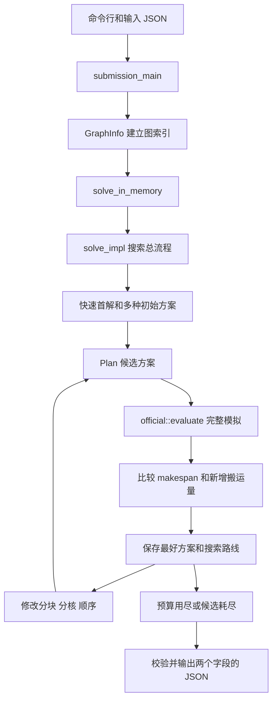

# 前辈代码_cpp 从入门到函数索引

这套程序接收一张计算图和核心数，寻找切图、分核与执行顺序，输出 JSON 方案。读懂它，需要先区分“题目数据”“候选方案”“评估结果”，再看函数如何在三者之间转换。

本指南覆盖工程自有 C++ 结构体、类、普通函数、成员函数、具名局部 lambda。头文件中的声明和源文件中的实现合并解释；条件编译入口、重载和特殊成员另作说明。无名称的排序比较器、回调按所属函数的用途解释。第三方 JSON 与 SHA-256 库说明项目使用的接口，不逐项展开第三方内部实现。

正式时限按《提交要求文档》：整个运行预算 90 秒，搜索目标截止于第 85 秒，预留 5 秒校验与写出。独立本地目标 `npu_sched_local` 使用 30 秒总预算；开发工具的单图默认值为 30 秒、批量默认值为 300 秒。这里解释的是当前代码行为，不把工程现状等同于全部提交条款已经验收。

2026-10-30 并行更新：`parallel.hpp` 提供三条后台线程及调用线程共同执行的计算池，嵌套工作顺序运行。种子来源和代表种子重排、候选粗筛、小批量精评、每核评分准备可并行；选解与全局事件模拟保持顺序。种子来源已由生成器改成返回候选列表，路线仍使用生成器保存推进位置。下文旧 GitHub 行号对应更新前版本，当前实现和验证范围以 README、`reports/PARALLEL_20261030.md` 为准。

同日激进优化补充：`visit_structure_seeds` / `visit_pipeline_seeds` 逐个调用 `SeedVisitor`，访问者返回 false 时立即停止。原列表接口仍可完整枚举；搜索中的 `collect_seeds` 在 compact 模式只取前两个，且保留局部截止前的结果。`solve_impl` 在普通种子前尝试重块拆分及同核四段细分；不超过 30 秒的短预算在早期改善超过 2% 后减少广泛构造。`explore` 只在生命周期邻域展开 profile。实现差异和本轮实测见 `reports/AGGRESSIVE_MERGE_20261030.md`。

当前已按要求删除问题 1、问题 3 和独立单核评估模块；本指南只讲剩余代码。两个求解入口都接受 2..5 核。`single_core_plan` 是多核搜索中“暂时把工作集中在核 0、其他核留空”的候选构造器，仍用于后续迁移和空核激活。

## 1 先认识题目里的对象

| 名词 | 用日常语言理解 | 在程序中的形式 |
| --- | --- | --- |
| Op / 算子 | 一项计算或搬运工作 | 输入 `ops` 数组中的记录 |
| Tensor / 张量 | 算子的输入或输出数据 | `tensors` 中的记录，包含大小和位置 |
| Edge / 依赖边 | 谁必须等谁的数据 | `edges` 中的 source、target |
| DAG | 没有循环依赖的有向图 | 允许先排好所有工作的先后关系 |
| Block / Subgraph / 子图 | 打包在一起的一组算子 | `Plan.blocks` |
| Core / 核 | 接受任务的一个 NPU 核心 | 编号从 0 开始 |
| Pipe / 流水线 | 核内部负责一类工作的执行通道 | M、V、MTE2、MTE3，当前实现还支持 FIX |
| Task | 评估器实际准备的一份任务 | 场景 B 中，同一个核的全部子图组成一个 Task |
| Makespan | 所有工作结束时的时间 | 模拟周期数 cycles，越小越好 |
| Spill | 片上空间不足，暂时把数据放到 DDR，之后取回 | 评估器插入 COPY 与重载张量 |
| Seed / 初始方案 | 搜索起跑时的一种方案 | `Plan` 或带标签的 `NamedPlans` |
| Neighborhood / 邻域 | 对当前方案做一次小修改形成的候选集合 | 迁移、交换、拆分、合并、重排序 |
| Profile | 指出哪里拥堵、占内存或搬运很多的分析报告 | `official::build_profile` 返回的 JSON |
| Checkpoint | 保存到磁盘的最好方案与评分 | 开发入口的 `best_checkpoint.json` |

程序在电脑上“找方案”的秒数，与方案在模拟 NPU 上“执行”的 cycles，是两种时间。`-n 4` 表示模拟 4 个 NPU 核，并不表示电脑开 4 个搜索线程。

## 2 看 C++ 时先把这些写法翻译出来

| 写法 | 在这里是什么意思 |
| --- | --- |
| `.hpp` / `.cpp` | `.hpp` 通常声明有哪些类型和函数；`.cpp` 给出具体实现。看到同名函数两次通常只是声明加定义 |
| `struct` / `class` | 把相关数据和函数放在一起。主要语法区别是成员默认 public / private |
| `using Id = ...` | 给类型起一个短名字，未创建变量 |
| `std::vector<T>` | 按顺序保存多个 T；本工程经常是 ID 列表 |
| `std::map<K,V>` | 通过键 K 查值 V，例如“算子编号→所属子图” |
| `std::set<T>` | 不重复的集合；本工程的整数集合按数值排序 |
| `std::optional<Plan>` | 可能有一个方案，也可能没有；空值不是一个空方案 |
| `std::pair<A,B>` / `tuple` | 一次打包返回两个或多个值；比较时按第一个、第二个依次比较 |
| `const GraphInfo &g` | 借用已有图，不复制，也不通过该引用修改图 |
| `auto` | 让编译器根据右侧推断类型；类型在编译时确定 |
| `for (auto [b,c] : ...)` | 遍历键值对，分别命名为 b 和 c；带 `&` 时借用元素 |
| `Plan::to_dict()` | `Plan` 类型的成员函数；需要一个方案对象来调用 |
| `official::evaluate(...)` | `official` 命名空间中的函数，不是某个对象的方法 |
| `auto f = [&](...) { ... };` | 创建局部小函数 lambda；`[&]` 借用外部变量。大量搜索逻辑写成这种形式 |
| `std::function<...>` | 可调用对象的容器，可以保存 lambda 并稍后调用 |
| `x.at(key)` | 读取已有项，缺少键会报错；`map[key]` 在缺少键时会建立默认值 |
| `return {};` | 返回空值或默认对象，具体含义由返回类型决定 |
| `throw` / `try` / `catch` | 报错并跳到对应异常处理；不必每层手工传递错误码 |
| `~Type()` | 析构函数，对象退出作用域时自动清理资源 |
| `std::move(x)` | 允许转移 x 持有的资源；不是把图上的算子迁到另一个核 |
| `namespace { ... }` | 当前源文件内部使用的辅助函数或类型；别的文件中同名不冲突 |
| `#ifdef NPU_SCHED_ENTRY` | 编译时选择正式入口；未定义该宏则编译开发入口 |

本项目频繁使用的短变量：`g`=图，`p`=方案，`v/op`=算子编号，`tid`=张量编号，`b`=子图编号，`c`=核编号，`preds/succs`=前驱/后继，`pos` 可能是存储位置或序列位置，须结合所在函数看。

## 3 整个程序如何连起来



`main` 负责运行流程；`search` 决定尝试哪些方案；`core` 提供方案的数据结构和修改操作；`official` 与 `official_code` 算出候选方案的执行表现。正式入口和开发入口共用搜索与评估算法，输入输出管理方式不同。

候选估算有两层。`Sketch` 等快速模型成本低，用于挑选值得精评的候选；`official::evaluate` 调用完整模拟，决定是否把方案记为最好。估算值与最终评分不能混用。这里名为 `official` 的模块是本地移植的评估实现，比赛最终成绩仍由指定官方评估器决定。

## 4 最重要的数据结构

### GraphInfo 保存题目数据

可以把 `GraphInfo` 当成“把题目整理成随手可查的表”。它本身不决定算子放哪个核。

| 字段 | 含义 |
| --- | --- |
| `graph` | 原始计算图 JSON |
| `ops`、`tensors` | 用编号查算子或张量记录 |
| `ids`、`eligible` | 需要分块的非 COPY 算子编号，分别用列表和集合保存 |
| `id_order` | 按 ID 打破并列关系的一种合法拓扑顺序 |
| `preds`、`succs` | 每个待分块算子的前驱、后继；已经跨过被排除的 COPY 节点连回依赖 |
| `producers`、`consumers` | 张量→全部生产它或消费它的算子集合 |
| `eligible_producers`、`eligible_consumers` | 上述集合中参与分块的非 COPY 算子 |
| `op_inputs`、`op_outputs` | 算子→输入、输出张量列表 |
| `external_input_groups` | 没有核内生产者的输入张量→使用它的核内算子 |
| `original_output_relations` | 需要作为图输出的张量→生产它的核内算子 |
| `weight` | 算子构造权重，至少取 1 |
| `rank` | 从该算子走向后续节点的最长剩余计算路径权重 |
| `position` | 算子在 `id_order` 中的位置 |
| `atoms`、`atom_of` | 弱连通分量的算子列表，以及算子属于哪个分量 |
| `edge_bytes` | 算子依赖之间涉及的数据量，供分核代价估计 |
| `direct_edges`、`direct_inputs` | 输入中直接 Op→Op 边的记录及按目标算子的索引，是当前实现的兼容路径 |

共享同一份输入并不自动产生两个消费者之间的先后依赖；生产者与消费者的关系才产生数据依赖。

### Plan 保存一种解法

`Plan` 只描述怎么切、怎么放、怎么排，不保存完整模拟的开始结束时刻。

| 字段 | 含义 |
| --- | --- |
| `blocks` | 子图编号→该子图中的算子列表 |
| `core_of` | 子图编号→分配到哪个核 |
| `order` | 满足跨子图依赖的全局子图顺序；导出时提取每个核自己的子序列 |
| `next_block_id` | 下次拆块时分配的新编号，必须大于已有子图编号 |
| `ncores` | 总核数，包含没有工作的空闲核 |

例如算子依赖为 `1 → 2 → 3`，有一种内部方案：

```cpp
blocks = {{10, {1, 2}}, {20, {3}}};
core_of = {{10, 0}, {20, 1}};
order = {10, 20};
next_block_id = 21;
ncores = 2;
```

意思是：算子 1、2 打包成子图 10，放核 0；算子 3 属于子图 20，放核 1。导出结果是：

```json
{
  "node_to_subgraph": {"1": 10, "2": 10, "3": 20},
  "core_schedules": [[10], [20]]
}
```

注意 `core_schedules` 放的是子图 ID，不是算子 ID。`order` 不是把所有核强行串行化的一条时间线；不同核和不同流水线能否重叠，由评估器根据依赖和资源规则决定。

### 搜索中的几种包装

`Candidate` 是“待评估的方案”，`SearchRow` 是“已经有评分的方案”，`Route` 是“围绕某一组方案继续探索的一条路线”。

| 类型 | 字段和作用 |
| --- | --- |
| `Settings` | `capacity` 是 L1/UB 容量；`bandwidth` 是带宽；`cross_core_copy_delay` 是跨核等待周期 |
| `Candidate` | `kind` 是修改类别，`label` 是具体名字，`plan` 是方案，`needs_repair` 标记是否适合再做顺序修复 |
| `SearchRow` | `score` 是目标值对，`plan` 是方案，`result` 是完整评分包装，`label` 是来源名称 |
| `Objective` | `pair<double,Id>`，依次表示 makespan 和新增搬运字节数，按字典序比较 |
| `Route` | `graph/name/reference/compact` 标识图、路线和策略；`best` 保存该路线最好方案；`pool` 是备选优秀方案；`visited/evaluated/repaired` 防重复；`reordered/activated` 记录已尝试的分核关系；`initial` 是起点时间评分，`seconds/repair_cost` 是已用时间与修复耗时；`repair_failures/repair_opportunities` 记录修复失败/机会次数，`stats` 汇总探索情况 |

例如 `(100,1000) < (101,0)`，因为先看时间。`(100,800) < (100,1000)`，因为时间一样再看搬运量。这里没有把两个指标随意加权成一个正式评分。

`SearchOptions` 控制搜索方式：

| 字段 | 含义 |
| --- | --- |
| `time_limit` | 搜索预算秒数；正式入口覆盖默认值，使用 90 秒总额度扣除输入与收尾后的余额 |
| `feasibility_grace` | 开发模式可给尚未找到首个有效方案的情况增加有限时间，正式入口为 0 |
| `warm_start` | 显式给出的起始方案文件 |
| `inherited_checkpoint` | 继承较低核数的检查点 |
| `resume_checkpoint` | 恢复同核数检查点的内部选项 |
| `ablation` | 实验中关闭某些策略，用于比较各策略贡献 |
| `max_evaluations` | 最多精评多少次，0 表示不按次数限制 |
| `compact` | 缩小种子、路线、候选数量等探索宽度 |
| `export_results` | 是否让搜索层导出结果文件；正式入口为 false，由入口统一写最终方案 |

字段存在不等于正式命令行允许传入。正式入口拒绝外部方案/检查点；开发命令行也只暴露这些选项中的一部分。

## 5 按模块查看全部自有 C++ 接口与辅助函数

以下表格的函数名可点击定位源码。输入→输出表示数据流；“局部”表示定义在某个函数内部的 lambda，不能直接从别的模块调用。

### 5.1 common 公共类型与小工具

类型别名：`Id` 是 64 位整数；`Ids` 是 ID 列表；`IdSet` 是 ID 集合；`Adjacency` 是 ID→ID 集合；`Records` 是 ID→JSON 记录；`Capacity` 是存储区域名称→容量。`Json` 是有序 JSON；`fs` 是文件系统命名空间。

`GraphViews` 保存 `inputs/outputs`（算子→张量）和 `preds/succs/producers/consumers`（依赖与生产消费关系）。`TimeoutError` 表示预算耗尽；`NoFeasiblePlanError` 表示未得到可执行方案。

| 名称与源码位置 | 功能、输入与输出 |
| --- | --- |
| [path_from_utf8](https://github.com/xztqaqmax67-cmyk/2626_hackson_17/blob/main/%E5%89%8D%E8%BE%88%E4%BB%A3%E7%A0%81_cpp/problem2/common.hpp#L38) | UTF-8 字符串→本机文件系统路径，支持中文路径。 |
| [path_utf8](https://github.com/xztqaqmax67-cmyk/2626_hackson_17/blob/main/%E5%89%8D%E8%BE%88%E4%BB%A3%E7%A0%81_cpp/problem2/common.hpp#L41) | 文件系统路径→UTF-8 字符串，供 JSON、日志、命令行使用。 |
| [key](https://github.com/xztqaqmax67-cmyk/2626_hackson_17/blob/main/%E5%89%8D%E8%BE%88%E4%BB%A3%E7%A0%81_cpp/problem2/common.hpp#L51) | 整数 ID→十进制字符串；JSON 对象的键需要字符串。 |
| [number](https://github.com/xztqaqmax67-cmyk/2626_hackson_17/blob/main/%E5%89%8D%E8%BE%88%E4%BB%A3%E7%A0%81_cpp/problem2/common.hpp#L54) | JSON 数字→`Id`。 |
| [field_id](https://github.com/xztqaqmax67-cmyk/2626_hackson_17/blob/main/%E5%89%8D%E8%BE%88%E4%BB%A3%E7%A0%81_cpp/problem2/common.hpp#L57) | JSON 记录和字段名→整数；默认取 `id` 字段。 |
| [field_string](https://github.com/xztqaqmax67-cmyk/2626_hackson_17/blob/main/%E5%89%8D%E8%BE%88%E4%BB%A3%E7%A0%81_cpp/problem2/common.hpp#L60) | JSON 记录和字段名→字符串。 |
| [as_set](https://github.com/xztqaqmax67-cmyk/2626_hackson_17/blob/main/%E5%89%8D%E8%BE%88%E4%BB%A3%E7%A0%81_cpp/problem2/common.hpp#L63) | ID 列表→去重且排序的集合。 |
| [as_vector](https://github.com/xztqaqmax67-cmyk/2626_hackson_17/blob/main/%E5%89%8D%E8%BE%88%E4%BB%A3%E7%A0%81_cpp/problem2/common.hpp#L66) | 集合→列表，供遍历和排序。 |
| [append](https://github.com/xztqaqmax67-cmyk/2626_hackson_17/blob/main/%E5%89%8D%E8%BE%88%E4%BB%A3%E7%A0%81_cpp/problem2/common.hpp#L69) | 把一个 vector 的元素追加到另一个 vector。 |
| [append_json](https://github.com/xztqaqmax67-cmyk/2626_hackson_17/blob/main/%E5%89%8D%E8%BE%88%E4%BB%A3%E7%A0%81_cpp/problem2/common.hpp#L72) | 把 JSON 数组元素追加到目标 JSON 数组。 |
| [index_records](https://github.com/xztqaqmax67-cmyk/2626_hackson_17/blob/main/%E5%89%8D%E8%BE%88%E4%BB%A3%E7%A0%81_cpp/problem2/common.hpp#L77) | 记录数组→以每条记录 `id` 为键的索引表。 |
| [record_ids](https://github.com/xztqaqmax67-cmyk/2626_hackson_17/blob/main/%E5%89%8D%E8%BE%88%E4%BB%A3%E7%A0%81_cpp/problem2/common.hpp#L84) | 记录索引表→其中全部 ID 的集合。 |
| [monotonic](https://github.com/xztqaqmax67-cmyk/2626_hackson_17/blob/main/%E5%89%8D%E8%BE%88%E4%BB%A3%E7%A0%81_cpp/problem2/common.hpp#L91) | 返回单调时钟秒数，用于计算经过时间；不是日期时间。 |
| [check_deadline](https://github.com/xztqaqmax67-cmyk/2626_hackson_17/blob/main/%E5%89%8D%E8%BE%88%E4%BB%A3%E7%A0%81_cpp/problem2/common.hpp#L102) | 检查传入的绝对截止时刻，已经到期则抛 `TimeoutError`；0 表示未启用。 |
| [poll_search_deadline](https://github.com/xztqaqmax67-cmyk/2626_hackson_17/blob/main/%E5%89%8D%E8%BE%88%E4%BB%A3%E7%A0%81_cpp/problem2/common.hpp#L109) | 检查当前线程的 `execution_deadline`。 |
| [submission_settings](https://github.com/xztqaqmax67-cmyk/2626_hackson_17/blob/main/%E5%89%8D%E8%BE%88%E4%BB%A3%E7%A0%81_cpp/problem2/common.hpp#L119) | 返回正式入口固定硬件参数：L1 1572864、UB 131072、带宽 60、跨核等待 1000。 |
| [copy_duration](https://github.com/xztqaqmax67-cmyk/2626_hackson_17/blob/main/%E5%89%8D%E8%BE%88%E4%BB%A3%E7%A0%81_cpp/problem2/common.hpp#L127) | 数据大小、独占带宽→向上取整的 COPY 周期数，至少 1。 |
| [max_record_id](https://github.com/xztqaqmax67-cmyk/2626_hackson_17/blob/main/%E5%89%8D%E8%BE%88%E4%BB%A3%E7%A0%81_cpp/problem2/common.hpp#L130) | 输入图→算子和张量中最大的 ID，帮助分配新编号。 |
| [is_copy](https://github.com/xztqaqmax67-cmyk/2626_hackson_17/blob/main/%E5%89%8D%E8%BE%88%E4%BB%A3%E7%A0%81_cpp/problem2/common.hpp#L139) | 判断操作名是否恰好是 `COPY_IN` 或 `COPY_OUT`。 |
| [edge](https://github.com/xztqaqmax67-cmyk/2626_hackson_17/blob/main/%E5%89%8D%E8%BE%88%E4%BB%A3%E7%A0%81_cpp/problem2/common.hpp#L142) | 两个 ID→一条默认 `data_size=0` 的 JSON 边记录。 |
| [object](https://github.com/xztqaqmax67-cmyk/2626_hackson_17/blob/main/%E5%89%8D%E8%BE%88%E4%BB%A3%E7%A0%81_cpp/problem2/common.hpp#L145) | 建立空 JSON 对象 `{}`。 |
| [array](https://github.com/xztqaqmax67-cmyk/2626_hackson_17/blob/main/%E5%89%8D%E8%BE%88%E4%BB%A3%E7%A0%81_cpp/problem2/common.hpp#L148) | 建立空 JSON 数组 `[]`。 |
| [id_map_json](https://github.com/xztqaqmax67-cmyk/2626_hackson_17/blob/main/%E5%89%8D%E8%BE%88%E4%BB%A3%E7%A0%81_cpp/problem2/common.hpp#L151) | 整数键 map→字符串键的 JSON 对象。 |

`build_graph_views` 在公共头文件声明，在下面的 `schedule_step1` 模块实现。`PIPES` 是流水线名称表。`execution_deadline` 是线程局部变量，生成器切换线程时会同步它。

### 5.2 core 图、方案和方案变换

| 名称与源码位置 | 功能、输入与输出 |
| --- | --- |
| [GraphInfo::GraphInfo](https://github.com/xztqaqmax67-cmyk/2626_hackson_17/blob/main/%E5%89%8D%E8%BE%88%E4%BB%A3%E7%A0%81_cpp/problem2/core.cpp#L9) | 输入 JSON→图索引对象；校验输入，排除 COPY 节点参与分块，建立依赖、拓扑顺序、关键路径权重和连通分量。 |
| [GraphInfo::from_path](https://github.com/xztqaqmax67-cmyk/2626_hackson_17/blob/main/%E5%89%8D%E8%BE%88%E4%BB%A3%E7%A0%81_cpp/problem2/core.cpp#L107) | 图文件路径→读取后构造 `GraphInfo`。 |
| [GraphInfo::topological_order](https://github.com/xztqaqmax67-cmyk/2626_hackson_17/blob/main/%E5%89%8D%E8%BE%88%E4%BB%A3%E7%A0%81_cpp/problem2/core.cpp#L111) | 模式→一种符合依赖的算子顺序；模式影响就绪节点之间如何选择，不取消依赖。 |
| [Plan::owner](https://github.com/xztqaqmax67-cmyk/2626_hackson_17/blob/main/%E5%89%8D%E8%BE%88%E4%BB%A3%E7%A0%81_cpp/problem2/core.cpp#L160) | 方案→算子 ID 到子图 ID 的反向映射。 |
| [Plan::to_dict](https://github.com/xztqaqmax67-cmyk/2626_hackson_17/blob/main/%E5%89%8D%E8%BE%88%E4%BB%A3%E7%A0%81_cpp/problem2/core.cpp#L170) | 内部方案→只有 `node_to_subgraph`、`core_schedules` 两字段的提交 JSON。 |
| [Plan::fingerprint](https://github.com/xztqaqmax67-cmyk/2626_hackson_17/blob/main/%E5%89%8D%E8%BE%88%E4%BB%A3%E7%A0%81_cpp/problem2/core.cpp#L189) | 方案→规范化 JSON 的 SHA-256，用于去重，不是评分。 |
| [Plan::validate](https://github.com/xztqaqmax67-cmyk/2626_hackson_17/blob/main/%E5%89%8D%E8%BE%88%E4%BB%A3%E7%A0%81_cpp/problem2/core.cpp#L193) | 图、当前方案→检查覆盖、重复、核数、块顺序、块内顺序和新 ID；成功返回 true，失败抛异常。不会模拟内存和执行时间。 |
| [Plan::from_dict](https://github.com/xztqaqmax67-cmyk/2626_hackson_17/blob/main/%E5%89%8D%E8%BE%88%E4%BB%A3%E7%A0%81_cpp/problem2/core.cpp#L302) | 图、提交 JSON→恢复内部 Plan，并重建满足依赖及每核顺序的全局顺序。 |
| [block_dependencies](https://github.com/xztqaqmax67-cmyk/2626_hackson_17/blob/main/%E5%89%8D%E8%BE%88%E4%BB%A3%E7%A0%81_cpp/problem2/core.cpp#L252) | 图、分块→子图层面的前驱表和后继表。 |
| [topological_blocks](https://github.com/xztqaqmax67-cmyk/2626_hackson_17/blob/main/%E5%89%8D%E8%BE%88%E4%BB%A3%E7%A0%81_cpp/problem2/core.cpp#L273) | 子图依赖、可选优先级→合法子图拓扑序。 |
| [build_blocks](https://github.com/xztqaqmax67-cmyk/2626_hackson_17/blob/main/%E5%89%8D%E8%BE%88%E4%BB%A3%E7%A0%81_cpp/problem2/core.cpp#L325) | 图、核数、大小限制→粗粒度初始分块；结合算子权重、连通分量和最大算子数。 |
| [single_core_plan](https://github.com/xztqaqmax67-cmyk/2626_hackson_17/blob/main/%E5%89%8D%E8%BE%88%E4%BB%A3%E7%A0%81_cpp/problem2/core.cpp#L353) | 图、总核数→全图在核 0 上的方案，其余核为空。 |
| [route_details](https://github.com/xztqaqmax67-cmyk/2626_hackson_17/blob/main/%E5%89%8D%E8%BE%88%E4%BB%A3%E7%A0%81_cpp/problem2/core.cpp#L365) | 图、方案→输入、输出、跨核搬运的账目与总量估计；同张量同核消费者去重，不计内存溢出新增搬运。 |
| [route_bytes](https://github.com/xztqaqmax67-cmyk/2626_hackson_17/blob/main/%E5%89%8D%E8%BE%88%E4%BB%A3%E7%A0%81_cpp/problem2/core.cpp#L421) | 图、方案→上述估计中的总 DDR 字节数。 |
| [pipe_loads](https://github.com/xztqaqmax67-cmyk/2626_hackson_17/blob/main/%E5%89%8D%E8%BE%88%E4%BB%A3%E7%A0%81_cpp/problem2/core.cpp#L424) | 图、方案→每个核每条流水线的计算工作量。 |
| [Sketch::Sketch](https://github.com/xztqaqmax67-cmyk/2626_hackson_17/blob/main/%E5%89%8D%E8%BE%88%E4%BB%A3%E7%A0%81_cpp/problem2/core.cpp#L439) | 图、核数、硬件参数→初始化轻量模拟器的流水线时钟和搬运缓存。 |
| [Sketch::transfer](https://github.com/xztqaqmax67-cmyk/2626_hackson_17/blob/main/%E5%89%8D%E8%BE%88%E4%BB%A3%E7%A0%81_cpp/problem2/core.cpp#L449) | 搬运标识、大小、源核、目标核、就绪时间→估计搬运结束时间并更新搬运记录。 |
| [Sketch::tensor_ready](https://github.com/xztqaqmax67-cmyk/2626_hackson_17/blob/main/%E5%89%8D%E8%BE%88%E4%BB%A3%E7%A0%81_cpp/problem2/core.cpp#L468) | 张量、目标核→估计输入数据何时在该核可用，必要时计入搬运。 |
| [Sketch::append](https://github.com/xztqaqmax67-cmyk/2626_hackson_17/blob/main/%E5%89%8D%E8%BE%88%E4%BB%A3%E7%A0%81_cpp/problem2/core.cpp#L495) | 一组算子、目标核→依次放入轻量模拟，更新完成时间、分核和搬运量，返回该组结束时间。 |
| [Sketch::makespan](https://github.com/xztqaqmax67-cmyk/2626_hackson_17/blob/main/%E5%89%8D%E8%BE%88%E4%BB%A3%E7%A0%81_cpp/problem2/core.cpp#L556) | 当前轻量模拟状态→估计的整体完成时间。 |
| [construct](https://github.com/xztqaqmax67-cmyk/2626_hackson_17/blob/main/%E5%89%8D%E8%BE%88%E4%BB%A3%E7%A0%81_cpp/problem2/core.cpp#L566) | 图、核数、搬运权重 lambda、硬件参数和可选分块→按关键路径优先顺序，尝试各核后贪心选择的初始 Plan。 |
| [replay_sketch_details](https://github.com/xztqaqmax67-cmyk/2626_hackson_17/blob/main/%E5%89%8D%E8%BE%88%E4%BB%A3%E7%A0%81_cpp/problem2/core.cpp#L614) | 图、固定方案、参数→轻量模拟的 makespan、搬运量、流水线可用时间与算子完成时间。 |
| [replay_sketch](https://github.com/xztqaqmax67-cmyk/2626_hackson_17/blob/main/%E5%89%8D%E8%BE%88%E4%BB%A3%E7%A0%81_cpp/problem2/core.cpp#L626) | 同上→仅取估计 makespan。 |
| [migrate](https://github.com/xztqaqmax67-cmyk/2626_hackson_17/blob/main/%E5%89%8D%E8%BE%88%E4%BB%A3%E7%A0%81_cpp/problem2/core.cpp#L629) | 方案、子图列表、目标核→这些子图移到目标核后的方案副本。 |
| [swap](https://github.com/xztqaqmax67-cmyk/2626_hackson_17/blob/main/%E5%89%8D%E8%BE%88%E4%BB%A3%E7%A0%81_cpp/problem2/core.cpp#L642) | 方案、两个子图→交换它们所属核心后的副本。 |
| [split_block](https://github.com/xztqaqmax67-cmyk/2626_hackson_17/blob/main/%E5%89%8D%E8%BE%88%E4%BB%A3%E7%A0%81_cpp/problem2/core.cpp#L647) | 图、方案、子图和可选切点→拆成两块后的可选方案；无法拆分则返回空。 |
| [merge_adjacent](https://github.com/xztqaqmax67-cmyk/2626_hackson_17/blob/main/%E5%89%8D%E8%BE%88%E4%BB%A3%E7%A0%81_cpp/problem2/core.cpp#L679) | 图、方案、待合并块和大小上限→符合条件时合并为一块，否则返回空。 |
| [insertion_bounds](https://github.com/xztqaqmax67-cmyk/2626_hackson_17/blob/main/%E5%89%8D%E8%BE%88%E4%BB%A3%E7%A0%81_cpp/problem2/core.cpp#L700) | 图、方案、子图→这个子图在全局顺序中可以插入的合法位置范围。 |
| [move_block](https://github.com/xztqaqmax67-cmyk/2626_hackson_17/blob/main/%E5%89%8D%E8%BE%88%E4%BB%A3%E7%A0%81_cpp/problem2/core.cpp#L718) | 图、方案、子图、位置→移动其顺序后的可选方案；依赖不允许则返回空。 |
| [lifetime_proxy_details](https://github.com/xztqaqmax67-cmyk/2626_hackson_17/blob/main/%E5%89%8D%E8%BE%88%E4%BB%A3%E7%A0%81_cpp/problem2/core.cpp#L729) | 图、方案、容量→按子图位置估计张量存活区间、各核内存峰值、超容量面积和字节跨度。 |
| [lifetime_proxy](https://github.com/xztqaqmax67-cmyk/2626_hackson_17/blob/main/%E5%89%8D%E8%BE%88%E4%BB%A3%E7%A0%81_cpp/problem2/core.cpp#L825) | 同上→`(excess_area, span_bytes)`；前者表示估计的超容量累积，后者表示数据大小乘存活跨度。 |
| [repair_order](https://github.com/xztqaqmax67-cmyk/2626_hackson_17/blob/main/%E5%89%8D%E8%BE%88%E4%BB%A3%E7%A0%81_cpp/problem2/core.cpp#L830) | 图、方案、参数、可选热点与影响范围→通过有限次合法顺序移动减少生命周期重叠；无变化返回空，改进仍需完整评估确认。 |
| [priority](https://github.com/xztqaqmax67-cmyk/2626_hackson_17/blob/main/%E5%89%8D%E8%BE%88%E4%BB%A3%E7%A0%81_cpp/problem2/core.cpp#L134) | `topological_order` 的局部函数：为就绪算子构造 ID/关键路径优先级。 |
| [local_key](https://github.com/xztqaqmax67-cmyk/2626_hackson_17/blob/main/%E5%89%8D%E8%BE%88%E4%BB%A3%E7%A0%81_cpp/problem2/core.cpp#L138) | `topological_order` 的局部函数：考虑已排前驱等局部关系来选择下一个算子。 |
| [key_for](https://github.com/xztqaqmax67-cmyk/2626_hackson_17/blob/main/%E5%89%8D%E8%BE%88%E4%BB%A3%E7%A0%81_cpp/problem2/core.cpp#L277) | `topological_blocks` 的局部函数：将块优先级和编号组合成确定的排序键。 |
| [add](https://github.com/xztqaqmax67-cmyk/2626_hackson_17/blob/main/%E5%89%8D%E8%BE%88%E4%BB%A3%E7%A0%81_cpp/problem2/core.cpp#L373) | `route_details` 的局部函数：追加一条搬运记录并累加字节数。 |
| [footprint](https://github.com/xztqaqmax67-cmyk/2626_hackson_17/blob/main/%E5%89%8D%E8%BE%88%E4%BB%A3%E7%A0%81_cpp/problem2/core.cpp#L957) | `repair_order` 的局部函数：估计一个块的输出张量总大小，帮助移动占用大的中间块。 |
| [score](https://github.com/xztqaqmax67-cmyk/2626_hackson_17/blob/main/%E5%89%8D%E8%BE%88%E4%BB%A3%E7%A0%81_cpp/problem2/core.cpp#L1028) | `repair_order` 的局部函数：组合轻量时间、带宽下界和生命周期指标，对修复候选排序。 |

`Sketch` 的 `graph_/settings_` 引用输入图和硬件参数；`available` 是各核各流水线何时可用；`fixed` 是累计计算量；`finish/core` 是算子的预计完成时间和所属核；`copy_out_/copy_in_/local_ready_/output_done_` 避免重复统计搬运或输出；`route_bytes` 累计估计搬运量。它不完整模拟 spill 和全局共享 DDR，只用于搜索引导。

### 5.3 bootstrap 快速首解

| 名称与源码位置 | 功能、输入与输出 |
| --- | --- |
| [first_plan](https://github.com/xztqaqmax67-cmyk/2626_hackson_17/blob/main/%E5%89%8D%E8%BE%88%E4%BB%A3%E7%A0%81_cpp/problem2/bootstrap.cpp#L5) | 图、核数→快速初始 Plan。独立分量充足且规模合适时，整组分到负载较小的核；否则按拓扑序分连续区间。结构校验通过不代表已经通过完整执行评估。 |

### 5.4 structure 利用图结构构造种子

| 名称与源码位置 | 功能、输入与输出 |
| --- | --- |
| [levels](https://github.com/xztqaqmax67-cmyk/2626_hackson_17/blob/main/%E5%89%8D%E8%BE%88%E4%BB%A3%E7%A0%81_cpp/problem2/structure.cpp#L5) | 图→算子距输入端的最长拓扑层数，从 0 开始，不按 cycles 加权。 |
| [stage_branches](https://github.com/xztqaqmax67-cmyk/2626_hackson_17/blob/main/%E5%89%8D%E8%BE%88%E4%BB%A3%E7%A0%81_cpp/problem2/structure.cpp#L17) | 图、阶段宽度、方向→阶段内弱连通分支列表及各分支的阶段编号；未给宽度时使用整图连通分量。 |
| [reverse_dfs_order](https://github.com/xztqaqmax67-cmyk/2626_hackson_17/blob/main/%E5%89%8D%E8%BE%88%E4%BB%A3%E7%A0%81_cpp/problem2/structure.cpp#L73) | 图→从输出向前驱访问后得到的一种合法顺序，作为结构候选的另一种排序。 |
| [total_work](https://github.com/xztqaqmax67-cmyk/2626_hackson_17/blob/main/%E5%89%8D%E8%BE%88%E4%BB%A3%E7%A0%81_cpp/problem2/structure.cpp#L111) | 局部辅助：流水线工作量表→各流水线工作量总和。 |
| [pack](https://github.com/xztqaqmax67-cmyk/2626_hackson_17/blob/main/%E5%89%8D%E8%BE%88%E4%BB%A3%E7%A0%81_cpp/problem2/structure.cpp#L118) | 分支、阶段、核数、参数→分支到核心的分配；兼顾负载均衡、重复输入和跨核搬运。 |
| [emit_plan](https://github.com/xztqaqmax67-cmyk/2626_hackson_17/blob/main/%E5%89%8D%E8%BE%88%E4%BB%A3%E7%A0%81_cpp/problem2/structure.cpp#L212) | 分支、阶段、分核→Plan；可把同阶段同核的分支合并，也可保持分支分开。 |
| [separator_assignment](https://github.com/xztqaqmax67-cmyk/2626_hackson_17/blob/main/%E5%89%8D%E8%BE%88%E4%BB%A3%E7%A0%81_cpp/problem2/structure.cpp#L250) | 图、核数、分隔阈值→可选的算子分核。先避开连接很多的节点切出分组，再分配这些连接节点。 |
| [allocation_plan](https://github.com/xztqaqmax67-cmyk/2626_hackson_17/blob/main/%E5%89%8D%E8%BE%88%E4%BB%A3%E7%A0%81_cpp/problem2/structure.cpp#L366) | 已有算子分核、排序模式→把顺序中连续属于同一核的算子打包成 Plan。 |
| [structure_seed_plans](https://github.com/xztqaqmax67-cmyk/2626_hackson_17/blob/main/%E5%89%8D%E8%BE%88%E4%BB%A3%E7%A0%81_cpp/problem2/structure.cpp#L397) | 图、核数、参数→多种带标签的结构初始方案，并按指纹去重。 |
| [unit_key](https://github.com/xztqaqmax67-cmyk/2626_hackson_17/blob/main/%E5%89%8D%E8%BE%88%E4%BB%A3%E7%A0%81_cpp/problem2/structure.cpp#L167) | `pack` 局部函数：重负载分支优先处理。 |
| [cost](https://github.com/xztqaqmax67-cmyk/2626_hackson_17/blob/main/%E5%89%8D%E8%BE%88%E4%BB%A3%E7%A0%81_cpp/problem2/structure.cpp#L178) | `pack` 局部函数：计算把某分支放到某核的负载和搬运代价。 |
| [cost](https://github.com/xztqaqmax67-cmyk/2626_hackson_17/blob/main/%E5%89%8D%E8%BE%88%E4%BB%A3%E7%A0%81_cpp/problem2/structure.cpp#L308) | `separator_assignment` 局部函数：计算把一个连通组分配到某核的负载代价。 |
| [cost](https://github.com/xztqaqmax67-cmyk/2626_hackson_17/blob/main/%E5%89%8D%E8%BE%88%E4%BB%A3%E7%A0%81_cpp/problem2/structure.cpp#L348) | `separator_assignment` 局部函数：为分隔节点选择核心，同时考虑与邻居之间的搬运。 |
| [flush](https://github.com/xztqaqmax67-cmyk/2626_hackson_17/blob/main/%E5%89%8D%E8%BE%88%E4%BB%A3%E7%A0%81_cpp/problem2/structure.cpp#L373) | `allocation_plan` 局部函数：把当前积累的同核算子封装为一个子图。 |
| [add](https://github.com/xztqaqmax67-cmyk/2626_hackson_17/blob/main/%E5%89%8D%E8%BE%88%E4%BB%A3%E7%A0%81_cpp/problem2/structure.cpp#L405) | `structure_seed_plans` 局部函数：给种子加标签，去重后加入结果。 |

### 5.5 pipeline 按流水线就绪时间构造与重排

`NamedPlans` 是 `(标签, Plan)` 列表。`Proposal` 保存一次“假设把某个算子放到某核”的尝试：`op/core` 为选择，`start/end` 为预计时刻，`bytes` 为新增搬运，`rows/routes` 为尝试产生的流水线和搬运状态变化。

`Placement` 保存已确认部分的状态：g/settings 引用图与参数，available/fixed 为流水线可用时间和累计计算量，finish/core 为算子预计结束时间和分核，routes 为已安排搬运的结束时间，bytes 为累计搬运量。`trial` 先试，`commit` 再采纳。

| 名称与源码位置 | 功能、输入与输出 |
| --- | --- |
| [Placement](https://github.com/xztqaqmax67-cmyk/2626_hackson_17/blob/main/%E5%89%8D%E8%BE%88%E4%BB%A3%E7%A0%81_cpp/problem2/pipeline.cpp#L22) | 图、核数、参数→初始化各核流水线的放置状态。 |
| [trial](https://github.com/xztqaqmax67-cmyk/2626_hackson_17/blob/main/%E5%89%8D%E8%BE%88%E4%BB%A3%E7%A0%81_cpp/problem2/pipeline.cpp#L32) | 算子、目标核→Proposal，估计输入到齐、流水线空闲、输出搬运等时间，不直接修改已确认状态。 |
| [commit](https://github.com/xztqaqmax67-cmyk/2626_hackson_17/blob/main/%E5%89%8D%E8%BE%88%E4%BB%A3%E7%A0%81_cpp/problem2/pipeline.cpp#L121) | Proposal→将其流水线时钟、搬运、算子完成时间和分核写入 Placement。 |
| [operation_plan](https://github.com/xztqaqmax67-cmyk/2626_hackson_17/blob/main/%E5%89%8D%E8%BE%88%E4%BB%A3%E7%A0%81_cpp/problem2/pipeline.cpp#L136) | 图、核数、负载权重、就绪窗口、优先级模式、可选固定分核和参考开始时间→单算子子图方案。 |
| [pipeline_seed_plans](https://github.com/xztqaqmax67-cmyk/2626_hackson_17/blob/main/%E5%89%8D%E8%BE%88%E4%BB%A3%E7%A0%81_cpp/problem2/pipeline.cpp#L234) | 图、核数、参数→关键路径优先、就绪窗口、负载均衡、广度优先等初始方案。 |
| [reorder_plans](https://github.com/xztqaqmax67-cmyk/2626_hackson_17/blob/main/%E5%89%8D%E8%BE%88%E4%BB%A3%E7%A0%81_cpp/problem2/pipeline.cpp#L253) | 图、已有方案、参数、可选评分→保留每个算子的分核关系，用不同优先级重排成候选；可以参考已模拟的开始时间。 |
| [row](https://github.com/xztqaqmax67-cmyk/2626_hackson_17/blob/main/%E5%89%8D%E8%BE%88%E4%BB%A3%E7%A0%81_cpp/problem2/pipeline.cpp#L36) | `Placement::trial` 局部函数：取一次尝试自己的流水线状态副本。 |
| [copy](https://github.com/xztqaqmax67-cmyk/2626_hackson_17/blob/main/%E5%89%8D%E8%BE%88%E4%BB%A3%E7%A0%81_cpp/problem2/pipeline.cpp#L42) | `Placement::trial` 局部函数：估计一次 COPY，复用已存在的同路线搬运记录。 |
| [transfer](https://github.com/xztqaqmax67-cmyk/2626_hackson_17/blob/main/%E5%89%8D%E8%BE%88%E4%BB%A3%E7%A0%81_cpp/problem2/pipeline.cpp#L55) | `Placement::trial` 局部函数：拼接源核 COPY_OUT、跨核等待、目标核 COPY_IN。 |

`operation_plan` 只从前驱已经安排完的算子中选择。就绪窗口为 8，表示在优先队列前 8 个就绪算子之间比较，并不允许越过未满足的数据依赖。

### 5.6 activation 尝试启用空闲核

| 名称与源码位置 | 功能、输入与输出 |
| --- | --- |
| [sum](https://github.com/xztqaqmax67-cmyk/2626_hackson_17/blob/main/%E5%89%8D%E8%BE%88%E4%BB%A3%E7%A0%81_cpp/problem2/activation.cpp#L7) | 局部辅助：流水线工作量→总工作量。 |
| [maximum](https://github.com/xztqaqmax67-cmyk/2626_hackson_17/blob/main/%E5%89%8D%E8%BE%88%E4%BB%A3%E7%A0%81_cpp/problem2/activation.cpp#L14) | 局部辅助：流水线工作量→最忙流水线的工作量。 |
| [parts](https://github.com/xztqaqmax67-cmyk/2626_hackson_17/blob/main/%E5%89%8D%E8%BE%88%E4%BB%A3%E7%A0%81_cpp/problem2/activation.cpp#L21) | 图、现有分核、源核、阶段宽度和分隔开关→该源核上可以尝试整体搬走的算子分组及归属表。 |
| [relocate](https://github.com/xztqaqmax67-cmyk/2626_hackson_17/blob/main/%E5%89%8D%E8%BE%88%E4%BB%A3%E7%A0%81_cpp/problem2/activation.cpp#L85) | Plan、要移动的算子集合、目标核→必要时切开原块并迁移所选部分，保持其余相对顺序。 |
| [activation_plans](https://github.com/xztqaqmax67-cmyk/2626_hackson_17/blob/main/%E5%89%8D%E8%BE%88%E4%BB%A3%E7%A0%81_cpp/problem2/activation.cpp#L109) | 图、方案、参数→从最多两个繁忙核挑选相关算子，迁到首个空闲核的有限候选集合。 |
| [order_key](https://github.com/xztqaqmax67-cmyk/2626_hackson_17/blob/main/%E5%89%8D%E8%BE%88%E4%BB%A3%E7%A0%81_cpp/problem2/activation.cpp#L227) | 局部函数：按可减轻的计算量和边界搬运代价给迁移分组排序。 |
| [loss](https://github.com/xztqaqmax67-cmyk/2626_hackson_17/blob/main/%E5%89%8D%E8%BE%88%E4%BB%A3%E7%A0%81_cpp/problem2/activation.cpp#L239) | 局部函数：衡量已选迁移工作量与目标比例的差距，帮助挑选若干组。 |

核空闲不一定是错误。激活只是尝试；跨核搬运和等待可能让新方案更慢，最终仍由完整评估决定。

### 5.7 portfolio 管理多条搜索路线

| 名称与源码位置 | 功能、输入与输出 |
| --- | --- |
| [objective](https://github.com/xztqaqmax67-cmyk/2626_hackson_17/blob/main/%E5%89%8D%E8%BE%88%E4%BB%A3%E7%A0%81_cpp/problem2/portfolio.cpp#L5) | 评分包装 JSON→`(makespan, added_copy_bytes)`。 |
| [assignment_key](https://github.com/xztqaqmax67-cmyk/2626_hackson_17/blob/main/%E5%89%8D%E8%BE%88%E4%BB%A3%E7%A0%81_cpp/problem2/portfolio.cpp#L8) | 图、Plan→按算子顺序列出所属核，识别相同的分核方式；不包含子图顺序。 |
| [seed_family](https://github.com/xztqaqmax67-cmyk/2626_hackson_17/blob/main/%E5%89%8D%E8%BE%88%E4%BB%A3%E7%A0%81_cpp/problem2/portfolio.cpp#L16) | 种子标签→来源类别，例如结构、流水线、继承方案。 |
| [diverse_rows](https://github.com/xztqaqmax67-cmyk/2626_hackson_17/blob/main/%E5%89%8D%E8%BE%88%E4%BB%A3%E7%A0%81_cpp/problem2/portfolio.cpp#L32) | 已评分方案列表、数量上限→优先选评分好且分核不同的方案，再补足其他不同方案。 |
| [polishing_seeds](https://github.com/xztqaqmax67-cmyk/2626_hackson_17/blob/main/%E5%89%8D%E8%BE%88%E4%BB%A3%E7%A0%81_cpp/problem2/portfolio.cpp#L58) | 已评分种子、上限→兼顾原生路线、种子来源与分核多样性的待重排种子。 |
| [Route::Route](https://github.com/xztqaqmax67-cmyk/2626_hackson_17/blob/main/%E5%89%8D%E8%BE%88%E4%BB%A3%E7%A0%81_cpp/problem2/portfolio.cpp#L95) | 图、路线名、初始方案等→初始化路线最好方案、统计和精英池。 |
| [Route::offer](https://github.com/xztqaqmax67-cmyk/2626_hackson_17/blob/main/%E5%89%8D%E8%BE%88%E4%BB%A3%E7%A0%81_cpp/problem2/portfolio.cpp#L123) | 新的 SearchRow→更新路线最好解和精英池；返回 2 表示时间改善，1 表示仅搬运改善，0 表示未改善路线最好值。 |
| [Route::next_center](https://github.com/xztqaqmax67-cmyk/2626_hackson_17/blob/main/%E5%89%8D%E8%BE%88%E4%BB%A3%E7%A0%81_cpp/problem2/portfolio.cpp#L155) | 路线状态→下一个尚未展开的精英方案；没有可探索中心则为空。 |
| [Route::repair_allowed](https://github.com/xztqaqmax67-cmyk/2626_hackson_17/blob/main/%E5%89%8D%E8%BE%88%E4%BB%A3%E7%A0%81_cpp/problem2/portfolio.cpp#L173) | 方案指纹→是否允许花时间修复；控制重复修复、修复耗时和连续失败。 |
| [Route::weight](https://github.com/xztqaqmax67-cmyk/2626_hackson_17/blob/main/%E5%89%8D%E8%BE%88%E4%BB%A3%E7%A0%81_cpp/problem2/portfolio.cpp#L182) | 路线收益与类型→分配探索机会的权重，参考路线及已有收益影响权重。 |
| [select_route](https://github.com/xztqaqmax67-cmyk/2626_hackson_17/blob/main/%E5%89%8D%E8%BE%88%E4%BB%A3%E7%A0%81_cpp/problem2/portfolio.cpp#L186) | 活动路线列表→选择已用时间除以权重最小的路线继续执行。 |
| [add](https://github.com/xztqaqmax67-cmyk/2626_hackson_17/blob/main/%E5%89%8D%E8%BE%88%E4%BB%A3%E7%A0%81_cpp/problem2/portfolio.cpp#L66) | `polishing_seeds` 局部函数：去重并记录已选方案的来源类别与分核方式。 |

### 5.8 search 搜索总流程与邻域

`TensorGroup`：`tid` 是张量，`traffic` 是相关搬运估计，`producers` 是生产它的子图集合，`groups` 按核聚集消费者子图。`Factory`：用 `kind/label/build/repair` 保存一个尚未执行的候选构造器。`EvaluationLimit` 是内部异常，用于在精评次数到达上限时正常结束搜索。

`solve_impl` 的主要阶段：建立时间预算和缓存 → 快速首解/继承方案 → 不同来源种子 → 选代表做顺序优化 → 建立多路线 → 生成、筛选、精评邻域 → 返回最好结果。每次拿到更好合法方案都会更新全局最好值。开发模式另外写检查点和指标文件。

| 名称与源码位置 | 功能、输入与输出 |
| --- | --- |
| [sum](https://github.com/xztqaqmax67-cmyk/2626_hackson_17/blob/main/%E5%89%8D%E8%BE%88%E4%BB%A3%E7%A0%81_cpp/problem2/search.cpp#L18) | 局部辅助：各流水线负载求和。 |
| [maximum](https://github.com/xztqaqmax67-cmyk/2626_hackson_17/blob/main/%E5%89%8D%E8%BE%88%E4%BB%A3%E7%A0%81_cpp/problem2/search.cpp#L25) | 局部辅助：取各流水线最大负载。 |
| [block_loads](https://github.com/xztqaqmax67-cmyk/2626_hackson_17/blob/main/%E5%89%8D%E8%BE%88%E4%BB%A3%E7%A0%81_cpp/problem2/search.cpp#L32) | 图、Plan→每个子图以及每个核的流水线工作量。 |
| [split](https://github.com/xztqaqmax67-cmyk/2626_hackson_17/blob/main/%E5%89%8D%E8%BE%88%E4%BB%A3%E7%A0%81_cpp/problem2/search.cpp#L46) | 局部辅助：按指定位置把一个块直接拆成两块；非法切点返回空，后续仍需校验候选。 |
| [insert](https://github.com/xztqaqmax67-cmyk/2626_hackson_17/blob/main/%E5%89%8D%E8%BE%88%E4%BB%A3%E7%A0%81_cpp/problem2/search.cpp#L59) | 局部辅助：把目标插入位置夹到合法范围，再调用 move_block。 |
| [tensor_groups](https://github.com/xztqaqmax67-cmyk/2626_hackson_17/blob/main/%E5%89%8D%E8%BE%88%E4%BB%A3%E7%A0%81_cpp/problem2/search.cpp#L68) | 图、Plan→按搬运潜力排序的 TensorGroup 列表，定位值得成组迁移的消费者。 |
| [pipe_bound](https://github.com/xztqaqmax67-cmyk/2626_hackson_17/blob/main/%E5%89%8D%E8%BE%88%E4%BB%A3%E7%A0%81_cpp/problem2/search.cpp#L107) | 图、Plan→不计等待与搬运时最忙核/流水线的计算量下界，用于剪枝。 |
| [neighborhoods](https://github.com/xztqaqmax67-cmyk/2626_hackson_17/blob/main/%E5%89%8D%E8%BE%88%E4%BB%A3%E7%A0%81_cpp/problem2/search.cpp#L115) | 图、中心方案、热点、完整结果、类别 family→Candidate 列表；三类覆盖分块/顺序、分核/负载、通信等待等修改。 |
| [solve_impl](https://github.com/xztqaqmax67-cmyk/2626_hackson_17/blob/main/%E5%89%8D%E8%BE%88%E4%BB%A3%E7%A0%81_cpp/problem2/search.cpp#L537) | 文件或内存输入、选项→统一执行完整搜索；返回统计记录，内存模式同时通过输出参数交回最好方案。 |
| [solve](https://github.com/xztqaqmax67-cmyk/2626_hackson_17/blob/main/%E5%89%8D%E8%BE%88%E4%BB%A3%E7%A0%81_cpp/problem2/search.cpp#L1391) | 图路径、核数、配置路径、工作目录、选项→调用 solve_impl 的文件/开发入口，返回搜索记录。 |
| [solve_in_memory](https://github.com/xztqaqmax67-cmyk/2626_hackson_17/blob/main/%E5%89%8D%E8%BE%88%E4%BB%A3%E7%A0%81_cpp/problem2/search.cpp#L1396) | GraphInfo、核数、选项→使用固定硬件参数调用 solve_impl，返回最好方案 JSON 或 null；正式 main 调用它。 |
| [add](https://github.com/xztqaqmax67-cmyk/2626_hackson_17/blob/main/%E5%89%8D%E8%BE%88%E4%BB%A3%E7%A0%81_cpp/problem2/search.cpp#L133) | `neighborhoods` 局部函数：把候选构造器按修改类别放入池。 |
| [add_plan](https://github.com/xztqaqmax67-cmyk/2626_hackson_17/blob/main/%E5%89%8D%E8%BE%88%E4%BB%A3%E7%A0%81_cpp/problem2/search.cpp#L143) | `neighborhoods` 局部函数：已有可选方案不为空时，包装成候选构造器。 |
| [compare](https://github.com/xztqaqmax67-cmyk/2626_hackson_17/blob/main/%E5%89%8D%E8%BE%88%E4%BB%A3%E7%A0%81_cpp/problem2/search.cpp#L443) | `neighborhoods` 局部函数：按当前块位置排列相关块。 |
| [rank](https://github.com/xztqaqmax67-cmyk/2626_hackson_17/blob/main/%E5%89%8D%E8%BE%88%E4%BB%A3%E7%A0%81_cpp/problem2/search.cpp#L459) | `neighborhoods` 局部函数：取块内算子的关键路径权重，用于延伸关键链。 |
| [io](https://github.com/xztqaqmax67-cmyk/2626_hackson_17/blob/main/%E5%89%8D%E8%BE%88%E4%BB%A3%E7%A0%81_cpp/problem2/search.cpp#L489) | `neighborhoods` 局部函数：估计块涉及的输入输出数据量，定位带宽竞争候选。 |
| [increment](https://github.com/xztqaqmax67-cmyk/2626_hackson_17/blob/main/%E5%89%8D%E8%BE%88%E4%BB%A3%E7%A0%81_cpp/problem2/search.cpp#L619) | `solve_impl` 局部函数：累计某项搜索次数。 |
| [timing](https://github.com/xztqaqmax67-cmyk/2626_hackson_17/blob/main/%E5%89%8D%E8%BE%88%E4%BB%A3%E7%A0%81_cpp/problem2/search.cpp#L622) | `solve_impl` 局部函数：累计某阶段用时。 |
| [recent](https://github.com/xztqaqmax67-cmyk/2626_hackson_17/blob/main/%E5%89%8D%E8%BE%88%E4%BB%A3%E7%A0%81_cpp/problem2/search.cpp#L625) | `solve_impl` 局部函数：取得最近若干次完整评估中的最大耗时，辅助预留时间。 |
| [check](https://github.com/xztqaqmax67-cmyk/2626_hackson_17/blob/main/%E5%89%8D%E8%BE%88%E4%BB%A3%E7%A0%81_cpp/problem2/search.cpp#L636) | `solve_impl` 局部函数：检查时间、可选收尾预留和最大评估次数；到期抛内部终止异常。 |
| [save_record](https://github.com/xztqaqmax67-cmyk/2626_hackson_17/blob/main/%E5%89%8D%E8%BE%88%E4%BB%A3%E7%A0%81_cpp/problem2/search.cpp#L645) | `solve_impl` 局部函数：刷新搜索统计；开发模式写 metrics.json，内存模式不落盘。 |
| [evaluate](https://github.com/xztqaqmax67-cmyk/2626_hackson_17/blob/main/%E5%89%8D%E8%BE%88%E4%BB%A3%E7%A0%81_cpp/problem2/search.cpp#L678) | `solve_impl` 局部函数：校验和去重候选，调用 official::evaluate，记录历史并更新全局最优；开发模式保存检查点。 |
| [expand](https://github.com/xztqaqmax67-cmyk/2626_hackson_17/blob/main/%E5%89%8D%E8%BE%88%E4%BB%A3%E7%A0%81_cpp/problem2/search.cpp#L784) | `solve_impl` 局部函数：构造并缓存候选的详细热点分析 profile。 |
| [cheap](https://github.com/xztqaqmax67-cmyk/2626_hackson_17/blob/main/%E5%89%8D%E8%BE%88%E4%BB%A3%E7%A0%81_cpp/problem2/search.cpp#L802) | `solve_impl` 局部函数：计算并缓存轻量时间/带宽估计与搬运量，用来排列候选。 |
| [row_for](https://github.com/xztqaqmax67-cmyk/2626_hackson_17/blob/main/%E5%89%8D%E8%BE%88%E4%BB%A3%E7%A0%81_cpp/problem2/search.cpp#L866) | 局部函数：将最近一次成功评分与对应 Plan、标签组成 SearchRow，失败则返回空。 |
| [legacy](https://github.com/xztqaqmax67-cmyk/2626_hackson_17/blob/main/%E5%89%8D%E8%BE%88%E4%BB%A3%E7%A0%81_cpp/problem2/search.cpp#L881) | 局部函数：依次产生搬运惩罚 lambda 为 0 和 1 的 construct 种子。 |
| [structure_source](https://github.com/xztqaqmax67-cmyk/2626_hackson_17/blob/main/%E5%89%8D%E8%BE%88%E4%BB%A3%E7%A0%81_cpp/problem2/search.cpp#L890) | 局部函数：通过生成器依次交出结构种子。 |
| [pipeline_source](https://github.com/xztqaqmax67-cmyk/2626_hackson_17/blob/main/%E5%89%8D%E8%BE%88%E4%BB%A3%E7%A0%81_cpp/problem2/search.cpp#L897) | 局部函数：通过生成器依次交出流水线种子。 |
| [activation_source](https://github.com/xztqaqmax67-cmyk/2626_hackson_17/blob/main/%E5%89%8D%E8%BE%88%E4%BB%A3%E7%A0%81_cpp/problem2/search.cpp#L904) | 局部函数：为继承方案产生启用额外核心的种子。 |
| [better](https://github.com/xztqaqmax67-cmyk/2626_hackson_17/blob/main/%E5%89%8D%E8%BE%88%E4%BB%A3%E7%A0%81_cpp/problem2/search.cpp#L967) | 局部比较器：按 SearchRow 的目标值比较。 |
| [assess](https://github.com/xztqaqmax67-cmyk/2626_hackson_17/blob/main/%E5%89%8D%E8%BE%88%E4%BB%A3%E7%A0%81_cpp/problem2/search.cpp#L1037) | 局部函数：评估一个候选并提交给指定 Route，返回路线改进等级和评分。 |
| [joint](https://github.com/xztqaqmax67-cmyk/2626_hackson_17/blob/main/%E5%89%8D%E8%BE%88%E4%BB%A3%E7%A0%81_cpp/problem2/search.cpp#L1050) | 局部函数：对新的分核关系接着尝试核内重排序，避免只改分核而错过顺序收益。 |
| [repair](https://github.com/xztqaqmax67-cmyk/2626_hackson_17/blob/main/%E5%89%8D%E8%BE%88%E4%BB%A3%E7%A0%81_cpp/problem2/search.cpp#L1070) | 局部函数：在允许的成本内提取 profile 并尝试生命周期修复，再完整评估。 |
| [finish](https://github.com/xztqaqmax67-cmyk/2626_hackson_17/blob/main/%E5%89%8D%E8%BE%88%E4%BB%A3%E7%A0%81_cpp/problem2/search.cpp#L1081) | `repair` 内部函数：记录修复耗时和成功/失败统计，异常退出时也更新。 |
| [explore](https://github.com/xztqaqmax67-cmyk/2626_hackson_17/blob/main/%E5%89%8D%E8%BE%88%E4%BB%A3%E7%A0%81_cpp/problem2/search.cpp#L1104) | 局部生成器：展开一条路线的精英中心，尝试重排、空核激活与各类邻域；yield 交回机会给其他路线。 |
| [update](https://github.com/xztqaqmax67-cmyk/2626_hackson_17/blob/main/%E5%89%8D%E8%BE%88%E4%BB%A3%E7%A0%81_cpp/problem2/search.cpp#L1344) | 路线调度循环内的局部函数：记录一次推进所花时间及步数，供下次路线选择。 |

`evaluate` 和 `official::evaluate` 不是同一个函数：前者是搜索层的局部包装，负责去重、记录、保优；后者真正调用场景 B 模拟。`cheap` 也不是正式评分。当前全局最好结果只由成功的完整评估更新。

### 5.9 official 给搜索使用的评估包装

| 名称与源码位置 | 功能、输入与输出 |
| --- | --- |
| [load_graph](https://github.com/xztqaqmax67-cmyk/2626_hackson_17/blob/main/%E5%89%8D%E8%BE%88%E4%BB%A3%E7%A0%81_cpp/problem2/official.cpp#L10) | 文件路径→严格读取并校验图，返回 JSON。 |
| [load_settings](https://github.com/xztqaqmax67-cmyk/2626_hackson_17/blob/main/%E5%89%8D%E8%BE%88%E4%BB%A3%E7%A0%81_cpp/problem2/official.cpp#L15) | 配置路径→读取容量、带宽和场景 B 跨核等待，返回 Settings。 |
| [error_type](https://github.com/xztqaqmax67-cmyk/2626_hackson_17/blob/main/%E5%89%8D%E8%BE%88%E4%BB%A3%E7%A0%81_cpp/problem2/official.cpp#L23) | 局部辅助：识别预期的图、切图、步骤 2/3、场景 B 异常，返回类型名字；未知异常返回空字符串。 |
| [failure](https://github.com/xztqaqmax67-cmyk/2626_hackson_17/blob/main/%E5%89%8D%E8%BE%88%E4%BB%A3%E7%A0%81_cpp/problem2/official.cpp#L41) | 把预期评估错误包装为 status/error/error_type；max_iter 超限标记 timeout，其余标记 invalid。未知错误重新抛出。 |
| [lifetimes](https://github.com/xztqaqmax67-cmyk/2626_hackson_17/blob/main/%E5%89%8D%E8%BE%88%E4%BB%A3%E7%A0%81_cpp/problem2/official.cpp#L52) | 图、执行序列、算子所属块、核号和可选时间线→张量使用区间；既可记录逻辑序列位置，也可附上模拟分配/释放时刻。 |
| [sorted](https://github.com/xztqaqmax67-cmyk/2626_hackson_17/blob/main/%E5%89%8D%E8%BE%88%E4%BB%A3%E7%A0%81_cpp/problem2/official.cpp#L66) | `lifetimes` 局部函数：按算子在序列中的位置排序使用者。 |
| [boundary_result](https://github.com/xztqaqmax67-cmyk/2626_hackson_17/blob/main/%E5%89%8D%E8%BE%88%E4%BB%A3%E7%A0%81_cpp/problem2/official.cpp#L139) | 图和已构建 Task→各核边界图、跨核 COPY 连接及搬运账本，不包括 spill 新增搬运。 |
| [build_boundary_graphs](https://github.com/xztqaqmax67-cmyk/2626_hackson_17/blob/main/%E5%89%8D%E8%BE%88%E4%BB%A3%E7%A0%81_cpp/problem2/official.cpp#L237) | 图、方案、带宽→只构造每核 Task 的边界和搬运，用于分析；不运行完整调度模拟。 |
| [route_cost](https://github.com/xztqaqmax67-cmyk/2626_hackson_17/blob/main/%E5%89%8D%E8%BE%88%E4%BB%A3%E7%A0%81_cpp/problem2/official.cpp#L241) | 图、方案→从边界图结果提取 route 搬运账目。 |
| [build_profile](https://github.com/xztqaqmax67-cmyk/2626_hackson_17/blob/main/%E5%89%8D%E8%BE%88%E4%BB%A3%E7%A0%81_cpp/problem2/official.cpp#L245) | 图、方案、参数、评分→展开 spill 后图，分析生命周期、内存压力、搬运和热点；供搜索定位值得修改的部分。 |
| [score](https://github.com/xztqaqmax67-cmyk/2626_hackson_17/blob/main/%E5%89%8D%E8%BE%88%E4%BB%A3%E7%A0%81_cpp/problem2/official.cpp#L340) | `build_profile` 内部排序键：优先看 spill 字节，其次看张量大小乘生命周期跨度，最多保留 16 个热点。 |
| [evaluate](https://github.com/xztqaqmax67-cmyk/2626_hackson_17/blob/main/%E5%89%8D%E8%BE%88%E4%BB%A3%E7%A0%81_cpp/problem2/official.cpp#L366) | 图、方案、参数→调用 evaluate_scene_b，包装 status、makespan、搬运、峰值及 official_result，可选附 profile；返回给搜索层。 |

### 5.10 schedule_step1 给一个 Task 排初始顺序

这一步只解决“先做哪个算子”，不分核，也不计算最终 makespan。输入图被组织为 GraphViews 后，从输出向前追溯依赖，保证生产者排在消费者之前。

| 名称与源码位置 | 功能、输入与输出 |
| --- | --- |
| [build_graph_views](https://github.com/xztqaqmax67-cmyk/2626_hackson_17/blob/main/%E5%89%8D%E8%BE%88%E4%BB%A3%E7%A0%81_cpp/problem2/official_code/schedule_step1.cpp#L5) | 算子数组、边数组→GraphViews，建立输入、输出、生产、消费、算子前驱和后继索引。 |
| [precompute_depth](https://github.com/xztqaqmax67-cmyk/2626_hackson_17/blob/main/%E5%89%8D%E8%BE%88%E4%BB%A3%E7%A0%81_cpp/problem2/official_code/schedule_step1.cpp#L41) | 依赖表、节点列表→各节点距源头的最长层数，用于打破排序并列。 |
| [step1_from_adj](https://github.com/xztqaqmax67-cmyk/2626_hackson_17/blob/main/%E5%89%8D%E8%BE%88%E4%BB%A3%E7%A0%81_cpp/problem2/official_code/schedule_step1.cpp#L63) | 依赖表、节点和算子记录→反向 DFS 得到合法顺序；使用显式栈，避免深递归。 |
| [order_key](https://github.com/xztqaqmax67-cmyk/2626_hackson_17/blob/main/%E5%89%8D%E8%BE%88%E4%BB%A3%E7%A0%81_cpp/problem2/official_code/schedule_step1.cpp#L70) | 局部排序键：考虑 COPY 类型、深度、编号；与栈弹出顺序共同决定访问顺序。 |
| [sorted](https://github.com/xztqaqmax67-cmyk/2626_hackson_17/blob/main/%E5%89%8D%E8%BE%88%E4%BB%A3%E7%A0%81_cpp/problem2/official_code/schedule_step1.cpp#L74) | 局部函数：使用 order_key 稳定排序一组待访问节点。 |
| [step1_schedule](https://github.com/xztqaqmax67-cmyk/2626_hackson_17/blob/main/%E5%89%8D%E8%BE%88%E4%BB%A3%E7%A0%81_cpp/problem2/official_code/schedule_step1.cpp#L124) | 图→先建立 GraphViews，再调用 step1_from_adj，返回算子 ID 列表。 |
| [check_topo](https://github.com/xztqaqmax67-cmyk/2626_hackson_17/blob/main/%E5%89%8D%E8%BE%88%E4%BB%A3%E7%A0%81_cpp/problem2/official_code/schedule_step1.cpp#L132) | 图、已有序列→检查每条依赖是否朝前；这是内部辅助检查，调用者应已保证序列完整。 |

### 5.11 schedule_step2 容量不足时插入换出与换入

可以把 L1/UB 想成容量有限的工作台。新操作需要放入数据时，若台面已满，就挑当前不用、下次使用最晚的数据暂时放到 DDR。当前操作正在用的数据不能被挑走。如果所有可用空间仍不够，会报错。

`TensorUses` 是“张量 ID→若干 `(序列位置, 算子 ID)`”。局部结构体 `Active` 保存 `tid`（当前驻留张量）、`next`（下次使用位置，可为空）、`used`（已处理的使用次数）。重载后会创建新物理张量 ID，并用 logical_tid/version 记住它来自哪份逻辑数据。

若 DDR 已有可复用备份，代码可以省略重复 COPY_OUT，只在需要时 COPY_IN。这是 spill 备份复用，仍是问题 2 的内存规则。

| 名称与源码位置 | 功能、输入与输出 |
| --- | --- |
| [build_tensor_uses](https://github.com/xztqaqmax67-cmyk/2626_hackson_17/blob/main/%E5%89%8D%E8%BE%88%E4%BB%A3%E7%A0%81_cpp/problem2/official_code/schedule_step2.cpp#L5) | 图、序列→收集每个张量在哪些序列位置使用，并去掉同一步重复记录。 |
| [find_copy_in_backings](https://github.com/xztqaqmax67-cmyk/2626_hackson_17/blob/main/%E5%89%8D%E8%BE%88%E4%BB%A3%E7%A0%81_cpp/problem2/official_code/schedule_step2.cpp#L35) | 图→查找由 COPY_IN 读入的张量在 DDR 中的唯一原始备份。 |
| [step2_spill_insertion](https://github.com/xztqaqmax67-cmyk/2626_hackson_17/blob/main/%E5%89%8D%E8%BE%88%E4%BB%A3%E7%A0%81_cpp/problem2/official_code/schedule_step2.cpp#L66) | 图、初始序列、容量→插入 spill 操作和重载张量；返回扩展序列、增删边、spill_records 和溢出记录。 |
| [put](https://github.com/xztqaqmax67-cmyk/2626_hackson_17/blob/main/%E5%89%8D%E8%BE%88%E4%BB%A3%E7%A0%81_cpp/problem2/official_code/schedule_step2.cpp#L96) | 局部函数：加入或更新驻留张量的下次使用位置和使用计数。 |
| [erase](https://github.com/xztqaqmax67-cmyk/2626_hackson_17/blob/main/%E5%89%8D%E8%BE%88%E4%BB%A3%E7%A0%81_cpp/problem2/official_code/schedule_step2.cpp#L106) | 局部函数：从驻留列表移除张量，返回是否真的移除了。 |
| [next_use](https://github.com/xztqaqmax67-cmyk/2626_hackson_17/blob/main/%E5%89%8D%E8%BE%88%E4%BB%A3%E7%A0%81_cpp/problem2/official_code/schedule_step2.cpp#L116) | 局部函数：查某张量下一次使用的序列位置，没有下一次则返回空。 |
| [copy_op](https://github.com/xztqaqmax67-cmyk/2626_hackson_17/blob/main/%E5%89%8D%E8%BE%88%E4%BB%A3%E7%A0%81_cpp/problem2/official_code/schedule_step2.cpp#L231) | 局部函数：为新增换出/换入生成 COPY 算子 JSON，记录大小和原始逻辑张量。 |
| [build_extended_graph](https://github.com/xztqaqmax67-cmyk/2626_hackson_17/blob/main/%E5%89%8D%E8%BE%88%E4%BB%A3%E7%A0%81_cpp/problem2/official_code/schedule_step2.cpp#L311) | 原图、步骤 2 结果→合并新增操作、张量和改写边，附上 seq_ext。 |
| [simulate_occupancy](https://github.com/xztqaqmax67-cmyk/2626_hackson_17/blob/main/%E5%89%8D%E8%BE%88%E4%BB%A3%E7%A0%81_cpp/problem2/official_code/schedule_step2.cpp#L320) | 扩展图→按扩展序列记录分配前后 L1/UB 占用、事件和峰值；属于序列上的占用分析。 |
| [alloc](https://github.com/xztqaqmax67-cmyk/2626_hackson_17/blob/main/%E5%89%8D%E8%BE%88%E4%BB%A3%E7%A0%81_cpp/problem2/official_code/schedule_step2.cpp#L334) | `simulate_occupancy` 局部函数：首次占用张量空间，更新计数与事件。 |
| [release](https://github.com/xztqaqmax67-cmyk/2626_hackson_17/blob/main/%E5%89%8D%E8%BE%88%E4%BB%A3%E7%A0%81_cpp/problem2/official_code/schedule_step2.cpp#L349) | `simulate_occupancy` 局部函数：最后一次使用后释放驻留空间，更新计数与事件。 |

### 5.12 schedule_step3 为 Task 建立可执行依赖

这一步考虑流水线先来先执行（FIFO）、数据就绪、片上容量以及内存复用。即使原图没有直接依赖，后面的算子若要复用前面释放的空间，也必须等前面的使用结束。

| 类型 | 字段和功能 |
| --- | --- |
| `Credit` | 一笔可用空间：bytes 为大小，sources 为释放它的操作，tid 为来源张量（初始空闲空间没有），kind 为 VIRGIN/WAR/WAW |
| `Dependency` | 一条因空间复用产生的等待：bytes、涉及的 tensors、依赖 kinds 和存储 positions |
| `PreparedTask` | 供全局模拟使用的一核任务，字段详见下表 |

WAR 可理解为“后来的写入要等前面的读取结束”；WAW 可理解为“后来的写入要等前面的写入结束”。这里通过容量额度记录这些关系，并不为张量分配真实硬件地址。

| PreparedTask 字段 | 含义 |
| --- | --- |
| raw_graph、raw_sequence、raw_op_subgraph | 插入 spill 之前的核内图、序列和算子所属子图 |
| spill_result | 步骤 2 的完整结果 |
| graph、step3 | 加入内存复用依赖的执行图，以及步骤 3 的完整模拟结果 |
| sequence、subgraphs | 扩展后的算子顺序，以及该核原来的子图顺序 |
| ops、tensors、views | 扩展图的记录索引与依赖索引 |
| sequence_position、op_subgraph | 算子在扩展序列中的位置，以及它所属子图 |
| pipe_ops | 每条流水线要依次执行的算子列表 |

只构造边界或分析 profile 时会提前返回，因此 PreparedTask 有些字段尚未填充；不能在任意阶段读取全部字段。

| 名称与源码位置 | 功能、输入与输出 |
| --- | --- |
| [op_duration](https://github.com/xztqaqmax67-cmyk/2626_hackson_17/blob/main/%E5%89%8D%E8%BE%88%E4%BB%A3%E7%A0%81_cpp/problem2/official_code/schedule_step3.cpp#L7) | 操作、图索引、张量、带宽→独占带宽时的周期数；COPY 按大小/带宽，其余按 cycles，至少 1。 |
| [uses_ddr_bandwidth](https://github.com/xztqaqmax67-cmyk/2626_hackson_17/blob/main/%E5%89%8D%E8%BE%88%E4%BB%A3%E7%A0%81_cpp/problem2/official_code/schedule_step3.cpp#L25) | 操作及相关张量→判断是否为涉及 DDR 的 COPY，需要参加共享带宽竞争。 |
| [step3_simulation](https://github.com/xztqaqmax67-cmyk/2626_hackson_17/blob/main/%E5%89%8D%E8%BE%88%E4%BB%A3%E7%A0%81_cpp/problem2/official_code/schedule_step3.cpp#L39) | 扩展图、容量、带宽→核内事件模拟，输出时间线、内存峰值、复用依赖和 execution_graph。 |
| [allocate](https://github.com/xztqaqmax67-cmyk/2626_hackson_17/blob/main/%E5%89%8D%E8%BE%88%E4%BB%A3%E7%A0%81_cpp/problem2/official_code/schedule_step3.cpp#L70) | 局部函数：分配张量占用，消费 Credit，记录此前空间来源所带来的依赖及内存事件。 |
| [release](https://github.com/xztqaqmax67-cmyk/2626_hackson_17/blob/main/%E5%89%8D%E8%BE%88%E4%BB%A3%E7%A0%81_cpp/problem2/official_code/schedule_step3.cpp#L116) | 局部函数：释放张量，将其容量及相关读取/写入操作记录成新的 Credit。 |
| [can_allocate](https://github.com/xztqaqmax67-cmyk/2626_hackson_17/blob/main/%E5%89%8D%E8%BE%88%E4%BB%A3%E7%A0%81_cpp/problem2/official_code/schedule_step3.cpp#L150) | 局部函数：检查操作的输出张量能否在当前容量内同时分配。 |
| [queue_if_ready](https://github.com/xztqaqmax67-cmyk/2626_hackson_17/blob/main/%E5%89%8D%E8%BE%88%E4%BB%A3%E7%A0%81_cpp/problem2/official_code/schedule_step3.cpp#L199) | 局部函数：前驱完成且排到本流水线队首后，加入待执行/待分配集合。 |
| [reschedule](https://github.com/xztqaqmax67-cmyk/2626_hackson_17/blob/main/%E5%89%8D%E8%BE%88%E4%BB%A3%E7%A0%81_cpp/problem2/official_code/schedule_step3.cpp#L216) | 局部函数：DDR 传输开始或结束时重算剩余搬运的结束时间，并可记录竞争过程。 |
| [prepare_step3_execution](https://github.com/xztqaqmax67-cmyk/2626_hackson_17/blob/main/%E5%89%8D%E8%BE%88%E4%BB%A3%E7%A0%81_cpp/problem2/official_code/schedule_step3.cpp#L465) | 扩展图、容量、带宽→运行步骤 3，提取执行图、流水线队列等，组成 PreparedTask。 |

| 名称与源码位置 | 功能、输入与输出 |
| --- | --- |
| [advance_ddr_work](https://github.com/xztqaqmax67-cmyk/2626_hackson_17/blob/main/%E5%89%8D%E8%BE%88%E4%BB%A3%E7%A0%81_cpp/problem2/official_code/schedule_step3.hpp#L26) | 剩余搬运工作量表、上次更新时间、当前时间→按同时活跃搬运均分带宽，扣掉已经完成的工作量。 |
| [project_ddr_ends](https://github.com/xztqaqmax67-cmyk/2626_hackson_17/blob/main/%E5%89%8D%E8%BE%88%E4%BB%A3%E7%A0%81_cpp/problem2/official_code/schedule_step3.hpp#L55) | 当前剩余工作量表和时刻→推算各项完成时间，考虑早完成的搬运退出后其余项获得更多带宽。 |

例如两次搬运各需独占带宽 10 个周期，同时开始且没有别的传输，它们平分带宽，会各用约 20 个周期。全局模拟共享的是一个 DDR 带宽池，不是每个核独占一份 60 bytes/cycle。

### 5.13 multicore_cut_evaluate_problem_2 全局场景 B 评分

此模块把一个 Plan 真正变成所有核心的执行时间线。流程是：同核子图合成 Task → 重建输入、输出及跨核 COPY → 各核执行步骤 1/2/3 → 合并全局依赖 → 共享 DDR 带宽下推进事件 → 统计 makespan 和搬运。

`SceneBTasks` 的 `tasks` 是核号→PreparedTask；`links` 保存跨核 COPY 连接；`traffic` 保存搬运统计；`plan_view` 保存派生的方案索引；`cross_traffic` 为跨核有效数据量，不能直接当作 COPY_IN+COPY_OUT 的总和。

构图时的局部 `TaskData` 只收集该核的 `ops/tensors/edges`、`op_subgraph` 和子图 `order`，随后转换成 PreparedTask。

| 名称与源码位置 | 功能、输入与输出 |
| --- | --- |
| [copy_traffic_bytes](https://github.com/xztqaqmax67-cmyk/2626_hackson_17/blob/main/%E5%89%8D%E8%BE%88%E4%BB%A3%E7%A0%81_cpp/problem2/official_code/multicore_cut_evaluate_problem_2.cpp#L9) | 图→合计其中 COPY_IN 输出/COPY_OUT 输入的张量字节数，用于搬运统计。 |
| [build_scene_b_tasks](https://github.com/xztqaqmax67-cmyk/2626_hackson_17/blob/main/%E5%89%8D%E8%BE%88%E4%BB%A3%E7%A0%81_cpp/problem2/official_code/multicore_cut_evaluate_problem_2.cpp#L24) | 图、方案、带宽、容量→SceneBTasks；重建每核图和跨核 COPY，再准备执行数据。boundary_only 只构边界；skip_execution 跳过步骤 3。 |
| [add_op](https://github.com/xztqaqmax67-cmyk/2626_hackson_17/blob/main/%E5%89%8D%E8%BE%88%E4%BB%A3%E7%A0%81_cpp/problem2/official_code/multicore_cut_evaluate_problem_2.cpp#L52) | 构图局部函数：给一个核添加算子并记录其所属子图。 |
| [add_copy](https://github.com/xztqaqmax67-cmyk/2626_hackson_17/blob/main/%E5%89%8D%E8%BE%88%E4%BB%A3%E7%A0%81_cpp/problem2/official_code/multicore_cut_evaluate_problem_2.cpp#L63) | 构图局部函数：建立 DDR 张量、COPY 算子及连接边，返回 COPY ID。 |
| [boundary_block](https://github.com/xztqaqmax67-cmyk/2626_hackson_17/blob/main/%E5%89%8D%E8%BE%88%E4%BB%A3%E7%A0%81_cpp/problem2/official_code/multicore_cut_evaluate_problem_2.cpp#L77) | 构图局部函数：在相关生产/消费子图中选择最晚生产块或最早消费块，放置边界 COPY。 |
| [link](https://github.com/xztqaqmax67-cmyk/2626_hackson_17/blob/main/%E5%89%8D%E8%BE%88%E4%BB%A3%E7%A0%81_cpp/problem2/official_code/multicore_cut_evaluate_problem_2.cpp#L90) | 构图局部函数：记录源核 COPY_OUT→目标核 COPY_IN 的联系，并累计跨核数据量。 |
| [validate_execution](https://github.com/xztqaqmax67-cmyk/2626_hackson_17/blob/main/%E5%89%8D%E8%BE%88%E4%BB%A3%E7%A0%81_cpp/problem2/official_code/multicore_cut_evaluate_problem_2.cpp#L248) | PreparedTask 集合、跨核连接→把数据依赖、内存复用、流水线 FIFO、跨核 COPY 合起来检查有向环。 |
| [evaluate_scene_b](https://github.com/xztqaqmax67-cmyk/2626_hackson_17/blob/main/%E5%89%8D%E8%BE%88%E4%BB%A3%E7%A0%81_cpp/problem2/official_code/multicore_cut_evaluate_problem_2.cpp#L284) | 图、Plan JSON、参数→完整场景 B 评分 JSON，包括 makespan、搬运、各核时间线、跨核传输和内存峰值。 |
| [queue](https://github.com/xztqaqmax67-cmyk/2626_hackson_17/blob/main/%E5%89%8D%E8%BE%88%E4%BB%A3%E7%A0%81_cpp/problem2/official_code/multicore_cut_evaluate_problem_2.cpp#L317) | 全局模拟局部函数：检查算子是否为流水线队首、前驱是否完成、跨核等待是否到期；就绪则加入待执行位置。 |
| [reschedule](https://github.com/xztqaqmax67-cmyk/2626_hackson_17/blob/main/%E5%89%8D%E8%BE%88%E4%BB%A3%E7%A0%81_cpp/problem2/official_code/multicore_cut_evaluate_problem_2.cpp#L351) | 全局模拟局部函数：DDR 活跃集合变化后，按共享带宽更新各 COPY 的预计结束时刻。 |

源核 COPY_OUT 完成后，目标核 COPY_IN 还必须满足跨核等待 delay。等待到期只是允许它开始，它仍可能等待自己的流水线或其他前驱。问题 3 的缓存分支已经移除，当前只模拟场景 B。

### 5.14 evaluation_validation 检查输入和依赖是否合法

| 名称与源码位置 | 功能、输入与输出 |
| --- | --- |
| [require_integer](https://github.com/xztqaqmax67-cmyk/2626_hackson_17/blob/main/%E5%89%8D%E8%BE%88%E4%BB%A3%E7%A0%81_cpp/problem2/official_code/evaluation_validation.cpp#L6) | JSON 值、字段名、最小值→要求为可容纳的整数且不小于下限，否则抛错。 |
| [require_number](https://github.com/xztqaqmax67-cmyk/2626_hackson_17/blob/main/%E5%89%8D%E8%BE%88%E4%BB%A3%E7%A0%81_cpp/problem2/official_code/evaluation_validation.cpp#L13) | JSON 值、字段名、是否严格正数→检查数值有限、非负或正数。 |
| [validate_capacity](https://github.com/xztqaqmax67-cmyk/2626_hackson_17/blob/main/%E5%89%8D%E8%BE%88%E4%BB%A3%E7%A0%81_cpp/problem2/official_code/evaluation_validation.cpp#L22) | 容量 JSON→要求恰好有 L1、UB 两项，且为非负整数。 |
| [trim](https://github.com/xztqaqmax67-cmyk/2626_hackson_17/blob/main/%E5%89%8D%E8%BE%88%E4%BB%A3%E7%A0%81_cpp/problem2/official_code/evaluation_validation.cpp#L31) | 去掉字符串两端空白，供配置解析使用。 |
| [read_integer_settings](https://github.com/xztqaqmax67-cmyk/2626_hackson_17/blob/main/%E5%89%8D%E8%BE%88%E4%BB%A3%E7%A0%81_cpp/problem2/official_code/evaluation_validation.cpp#L38) | 配置文件、节名、允许的键→读取该节整数设置；拒绝未知节、重复键、格式错误，文件不存在时返回空表。 |
| [read_required_settings](https://github.com/xztqaqmax67-cmyk/2626_hackson_17/blob/main/%E5%89%8D%E8%BE%88%E4%BB%A3%E7%A0%81_cpp/problem2/official_code/evaluation_validation.cpp#L88) | 同上→还要求所有必需键存在且非负。 |
| [read_capacity_config](https://github.com/xztqaqmax67-cmyk/2626_hackson_17/blob/main/%E5%89%8D%E8%BE%88%E4%BB%A3%E7%A0%81_cpp/problem2/official_code/evaluation_validation.cpp#L99) | 配置→读取 L1/UB 容量。 |
| [read_bandwidth_config](https://github.com/xztqaqmax67-cmyk/2626_hackson_17/blob/main/%E5%89%8D%E8%BE%88%E4%BB%A3%E7%A0%81_cpp/problem2/official_code/evaluation_validation.cpp#L102) | 配置→读取并检查正整数 bandwidth。 |
| [read_evaluation_config](https://github.com/xztqaqmax67-cmyk/2626_hackson_17/blob/main/%E5%89%8D%E8%BE%88%E4%BB%A3%E7%A0%81_cpp/problem2/official_code/evaluation_validation.cpp#L107) | 配置→读取容量和带宽，跨核 delay 由调用方另读；缺少文件报错。 |
| [validate_parameters](https://github.com/xztqaqmax67-cmyk/2626_hackson_17/blob/main/%E5%89%8D%E8%BE%88%E4%BB%A3%E7%A0%81_cpp/problem2/official_code/evaluation_validation.cpp#L113) | 带宽、容量、max_iter→检查模拟参数范围。 |
| [check_acyclic](https://github.com/xztqaqmax67-cmyk/2626_hackson_17/blob/main/%E5%89%8D%E8%BE%88%E4%BB%A3%E7%A0%81_cpp/problem2/official_code/evaluation_validation.cpp#L118) | 节点与边→用拓扑剥离检查是否有环；有环则报错，避免互相等待。 |
| [validate_graph](https://github.com/xztqaqmax67-cmyk/2626_hackson_17/blob/main/%E5%89%8D%E8%BE%88%E4%BB%A3%E7%A0%81_cpp/problem2/official_code/evaluation_validation.cpp#L155) | 图→检查数组、ID 唯一性、张量位置/大小、Pipe、cycles、边端点、重复边和有向环；仅 COPY 的 -1 耗时占位可通过。 |
| [validate_task_order](https://github.com/xztqaqmax67-cmyk/2626_hackson_17/blob/main/%E5%89%8D%E8%BE%88%E4%BB%A3%E7%A0%81_cpp/problem2/official_code/evaluation_validation.cpp#L221) | 派生方案→把子图依赖和每核执行顺序合起来检查是否成环。 |

### 5.15 stub_multicore_cut_and_schedule 方案索引与随机示例

名字有 stub，但并非所有函数都只是演示。`derive_multicore_plan` 是实际评估依赖的核心校验/索引函数。只有 `generate_multicore_plan` 是随机示例方案生成。

内部 `PythonRandom` 保存 `state[624]` 和游标 `index`，在 C++ 中复现原 Python 随机样例的整数取样结果；运行时不调用 Python。

| 名称与源码位置 | 功能、输入与输出 |
| --- | --- |
| [contract_excluded_copy_nodes](https://github.com/xztqaqmax67-cmyk/2626_hackson_17/blob/main/%E5%89%8D%E8%BE%88%E4%BB%A3%E7%A0%81_cpp/problem2/official_code/stub_multicore_cut_and_schedule.cpp#L6) | 参与分块的算子和原依赖→跨过不参与分块的 COPY 节点，保留计算算子间的前驱/后继关系。 |
| [derive_multicore_plan](https://github.com/xztqaqmax67-cmyk/2626_hackson_17/blob/main/%E5%89%8D%E8%BE%88%E4%BB%A3%E7%A0%81_cpp/problem2/official_code/stub_multicore_cut_and_schedule.cpp#L37) | 图、两字段方案→检查覆盖、重复、子图顺序和依赖，建立 mapping、nodes_by_subgraph、core_by_subgraph 等索引。 |
| [validate_multicore_plan](https://github.com/xztqaqmax67-cmyk/2626_hackson_17/blob/main/%E5%89%8D%E8%BE%88%E4%BB%A3%E7%A0%81_cpp/problem2/official_code/stub_multicore_cut_and_schedule.cpp#L151) | 图、方案→调用 derive_multicore_plan；通过则返回 true，否则抛异常。 |
| [generate_multicore_plan](https://github.com/xztqaqmax67-cmyk/2626_hackson_17/blob/main/%E5%89%8D%E8%BE%88%E4%BB%A3%E7%A0%81_cpp/problem2/official_code/stub_multicore_cut_and_schedule.cpp#L225) | 图、核数、随机种子、子图大小范围→随机合法拓扑顺序，切成块后随机放核；只是样例生成，不优化评分。 |
| [PythonRandom](https://github.com/xztqaqmax67-cmyk/2626_hackson_17/blob/main/%E5%89%8D%E8%BE%88%E4%BB%A3%E7%A0%81_cpp/problem2/official_code/stub_multicore_cut_and_schedule.cpp#L177) | 整数种子→初始化与 Python 整数种子对应的随机状态。 |
| [next](https://github.com/xztqaqmax67-cmyk/2626_hackson_17/blob/main/%E5%89%8D%E8%BE%88%E4%BB%A3%E7%A0%81_cpp/problem2/official_code/stub_multicore_cut_and_schedule.cpp#L160) | 内部方法：推进状态，产生下一份 32 位随机数。 |
| [below](https://github.com/xztqaqmax67-cmyk/2626_hackson_17/blob/main/%E5%89%8D%E8%BE%88%E4%BB%A3%E7%A0%81_cpp/problem2/official_code/stub_multicore_cut_and_schedule.cpp#L208) | 给定正整数 n→用拒绝采样返回 `0 <= x < n` 中的整数。 |

### 5.16 main、submission_io、utf8_entry 程序如何启动

`main.cpp` 被 CMake 编译两次：目标 `npu_sched` 带 `NPU_SCHED_ENTRY=1`，因此保留 `#ifdef` 内的正式 submission_main；目标 `problem2` 不带此宏，保留 `#else` 内的开发 submission_main。预处理完成后，每个可执行文件里只有自己的一份入口，运行时不会再判断用哪个。

Windows 从 `wmain` 进入，其他平台从 `main` 进入，经 utf8_entry 统一参数，再调用所选的 submission_main。

| 局部结构体 | 作用 |
| --- | --- |
| RestoreDeadline | previous 保存进入前的线程截止时间；析构时恢复，即使抛异常也会执行 |
| TemporaryWork | path 为工作目录，owned 表示是否为程序自行创建；析构时只清理符合临时目录范围和命名条件的自建目录 |
| SubmissionArguments | input/output 是路径，cores 默认 4，help/version 是两个独立显示开关 |

正式入口：解析参数 → 读图 → 设置搜索余额 → solve_in_memory → 校验 → 原子写出。开发入口还负责配置、临时目录、子进程墙钟限时、批量运行及导出评估文件。

| 名称与源码位置 | 功能、输入与输出 |
| --- | --- |
| [submission_main](https://github.com/xztqaqmax67-cmyk/2626_hackson_17/blob/main/%E5%89%8D%E8%BE%88%E4%BB%A3%E7%A0%81_cpp/problem2/main.cpp#L17) | 正式版本：固定硬件、2..5 核、90 秒总预算，调用内存搜索后写两字段方案；开发版本：解析调试参数并管理单例/批量搜索进程。 |
| [interrupt_handler](https://github.com/xztqaqmax67-cmyk/2626_hackson_17/blob/main/%E5%89%8D%E8%BE%88%E4%BB%A3%E7%A0%81_cpp/problem2/main.cpp#L97) | 开发版本信号回调：只设置 interrupted 标志，由正常流程结束本次搜索。 |
| [within](https://github.com/xztqaqmax67-cmyk/2626_hackson_17/blob/main/%E5%89%8D%E8%BE%88%E4%BB%A3%E7%A0%81_cpp/problem2/main.cpp#L100) | 检查路径是否位于指定目录内，规范化后逐段比较；Windows 忽略大小写。 |
| [parse_int](https://github.com/xztqaqmax67-cmyk/2626_hackson_17/blob/main/%E5%89%8D%E8%BE%88%E4%BB%A3%E7%A0%81_cpp/problem2/main.cpp#L196) | 开发入口局部函数：把参数完整解析为整数，拒绝数字后面带无效字符。 |
| [parse_double](https://github.com/xztqaqmax67-cmyk/2626_hackson_17/blob/main/%E5%89%8D%E8%BE%88%E4%BB%A3%E7%A0%81_cpp/problem2/main.cpp#L204) | 开发入口局部函数：把参数完整解析为浮点数，范围和有限性随后检查。 |
| [decimal](https://github.com/xztqaqmax67-cmyk/2626_hackson_17/blob/main/%E5%89%8D%E8%BE%88%E4%BB%A3%E7%A0%81_cpp/problem2/main.cpp#L373) | 开发入口局部函数：将截止时间等 double 用 17 位精度转成传给子进程的字符串。 |
| [wmain](https://github.com/xztqaqmax67-cmyk/2626_hackson_17/blob/main/%E5%89%8D%E8%BE%88%E4%BB%A3%E7%A0%81_cpp/problem2/main.cpp#L486) | Windows 程序入口，宽字符 argv 交给 utf8_entry。 |
| [main](https://github.com/xztqaqmax67-cmyk/2626_hackson_17/blob/main/%E5%89%8D%E8%BE%88%E4%BB%A3%E7%A0%81_cpp/problem2/main.cpp#L490) | 非 Windows 程序入口，UTF-8 参数交给 utf8_entry。 |

| 名称与源码位置 | 功能、输入与输出 |
| --- | --- |
| [safe_message](https://github.com/xztqaqmax67-cmyk/2626_hackson_17/blob/main/%E5%89%8D%E8%BE%88%E4%BB%A3%E7%A0%81_cpp/problem2/submission_io.cpp#L6) | 错误字符串→去掉其中绝对目录路径，只保留文件名，供用户错误提示使用。 |
| [parse_submission_arguments](https://github.com/xztqaqmax67-cmyk/2626_hackson_17/blob/main/%E5%89%8D%E8%BE%88%E4%BB%A3%E7%A0%81_cpp/problem2/submission_io.cpp#L25) | 字符串参数列表→SubmissionArguments；识别图路径、-n/--cores、-o/--output、help/version，拒绝未知项、重复项、缺值、非 2..5 核和覆盖输入。 |

`parse_submission_arguments({"graph.json", "-n", "4", "-o", "plan.json"})` 的结果相当于 input=graph.json、cores=4、output=plan.json。它只把字符串整理成参数对象，不读图、不搜索、不评分。`argc` 是参数总数，`argv[0]` 是程序名，所以正式入口传入 `argv+1` 到 `argv+argc`。

| 名称与源码位置 | 功能、输入与输出 |
| --- | --- |
| [utf8_entry](https://github.com/xztqaqmax67-cmyk/2626_hackson_17/blob/main/%E5%89%8D%E8%BE%88%E4%BB%A3%E7%A0%81_cpp/problem2/utf8_entry.hpp#L9) | Windows 版本把宽字符参数转成 UTF-8 并找到本程序完整路径；Linux 版本尝试从 /proc/self/exe 补全程序路径。随后调用传入的 run 函数。 |

### 5.17 contest_io 和 cli_main 本地评估/样例工具入口

`Arguments` 保存 positional（位置参数）、flags（命名参数值）和 help。它服务本地工具，与正式入口的 SubmissionArguments 是两套参数类型。

`cli_main.cpp` 也被编译为两个目标：定义 MULTICORE_STUB_ENTRY 的程序调用样例生成器，否则调用场景 B 评估器。

| 名称与源码位置 | 功能、输入与输出 |
| --- | --- |
| [scalar](https://github.com/xztqaqmax67-cmyk/2626_hackson_17/blob/main/%E5%89%8D%E8%BE%88%E4%BB%A3%E7%A0%81_cpp/problem2/official_code/contest_io.cpp#L9) | JSON 标量→日志字符串；字符串不额外加引号，整数形式的浮点值省略小数部分。 |
| [parse](https://github.com/xztqaqmax67-cmyk/2626_hackson_17/blob/main/%E5%89%8D%E8%BE%88%E4%BB%A3%E7%A0%81_cpp/problem2/official_code/contest_io.cpp#L23) | argc/argv、允许的选项集合→Arguments；支持 --key=value、空格传值和 -n/-o 别名。 |
| [option_path](https://github.com/xztqaqmax67-cmyk/2626_hackson_17/blob/main/%E5%89%8D%E8%BE%88%E4%BB%A3%E7%A0%81_cpp/problem2/official_code/contest_io.cpp#L57) | Arguments、选项名、默认路径→用户路径或默认路径。 |
| [format_data_movement_log](https://github.com/xztqaqmax67-cmyk/2626_hackson_17/blob/main/%E5%89%8D%E8%BE%88%E4%BB%A3%E7%A0%81_cpp/problem2/official_code/contest_io.cpp#L62) | 评分结果→一行搬运统计文本。 |
| [format_multicore_result_log](https://github.com/xztqaqmax67-cmyk/2626_hackson_17/blob/main/%E5%89%8D%E8%BE%88%E4%BB%A3%E7%A0%81_cpp/problem2/official_code/contest_io.cpp#L70) | 图名、结果→场景 B、makespan、核数及各核结束时间的日志。 |
| [format_trace_json](https://github.com/xztqaqmax67-cmyk/2626_hackson_17/blob/main/%E5%89%8D%E8%BE%88%E4%BB%A3%E7%A0%81_cpp/problem2/official_code/contest_io.cpp#L87) | 图名、结果→Perfetto/Chrome trace 格式文本；每核一组、各 Pipe 分轨，附子图跨度。 |
| [run_problem_cli](https://github.com/xztqaqmax67-cmyk/2626_hackson_17/blob/main/%E5%89%8D%E8%BE%88%E4%BB%A3%E7%A0%81_cpp/problem2/official_code/contest_io.cpp#L180) | 场景 B 评估工具主流程：解析图/方案/配置路径，评估，输出结果 JSON、trace 和 log。 |
| [suffix](https://github.com/xztqaqmax67-cmyk/2626_hackson_17/blob/main/%E5%89%8D%E8%BE%88%E4%BB%A3%E7%A0%81_cpp/problem2/official_code/contest_io.cpp#L194) | 评估入口局部函数：用图文件主名加后缀生成默认输出路径。 |
| [run_multicore_stub_cli](https://github.com/xztqaqmax67-cmyk/2626_hackson_17/blob/main/%E5%89%8D%E8%BE%88%E4%BB%A3%E7%A0%81_cpp/problem2/official_code/contest_io.cpp#L227) | 样例工具主流程：解析核数、seed、块大小，生成随机方案并写出。 |
| [integer](https://github.com/xztqaqmax67-cmyk/2626_hackson_17/blob/main/%E5%89%8D%E8%BE%88%E4%BB%A3%E7%A0%81_cpp/problem2/official_code/contest_io.cpp#L240) | 样例入口局部函数：读取命名整数参数，未提供则使用默认值。 |

| 名称与源码位置 | 功能、输入与输出 |
| --- | --- |
| [cli_entry](https://github.com/xztqaqmax67-cmyk/2626_hackson_17/blob/main/%E5%89%8D%E8%BE%88%E4%BB%A3%E7%A0%81_cpp/problem2/official_code/cli_main.cpp#L4) | 按编译宏选择调用 run_multicore_stub_cli 或 run_problem_cli。 |
| [wmain](https://github.com/xztqaqmax67-cmyk/2626_hackson_17/blob/main/%E5%89%8D%E8%BE%88%E4%BB%A3%E7%A0%81_cpp/problem2/official_code/cli_main.cpp#L12) | Windows 本地工具入口，通过 utf8_entry 转换参数。 |
| [main](https://github.com/xztqaqmax67-cmyk/2626_hackson_17/blob/main/%E5%89%8D%E8%BE%88%E4%BB%A3%E7%A0%81_cpp/problem2/official_code/cli_main.cpp#L16) | 其他平台本地工具入口，通过 utf8_entry 转交参数。 |

### 5.18 generator 保存搜索进行到哪里

Python 可以用 yield 暂停一个函数；此工程用 C++17 线程和条件变量保存调用栈，达到“下次从原位置继续”的效果。`Generator<T>` 每次 next() 返回一个 optional<T>，为空表示没有更多元素。

| 类型/字段 | 作用 |
| --- | --- |
| Yield、Producer | Yield 是“交出一个 T”的回调；Producer 是接收 Yield 回调的生产函数 |
| state_ | 独占持有当前生成器 State |
| State.mutex、changed | 互斥锁和条件变量，用来交接运行权 |
| State.produce、worker | 生产函数和保存其执行栈的线程 |
| State.value、error | 本次交出的值，或需要向调用者传播的异常 |
| State.resume/ready/done/stop | 请求继续、有值可取、已结束、请求取消四种状态标记 |
| State.deadline | 在调用者和生产者之间同步的截止时间 |
| Cancelled | 内部控制信号，用来结束被取消的生成过程 |

这些线程轮流运行。`next()` 等生产者交回值，生产者 yield 后又休眠，因此这里并不同时跑多路搜索。

| 名称与源码位置 | 功能、输入与输出 |
| --- | --- |
| [State](https://github.com/xztqaqmax67-cmyk/2626_hackson_17/blob/main/%E5%89%8D%E8%BE%88%E4%BB%A3%E7%A0%81_cpp/problem2/generator.hpp#L30) | 保存传入的生产函数，初始化其他交接状态。 |
| [produce](https://github.com/xztqaqmax67-cmyk/2626_hackson_17/blob/main/%E5%89%8D%E8%BE%88%E4%BB%A3%E7%A0%81_cpp/problem2/generator.hpp#L34) | 线程入口：等待首次唤醒，执行生产函数；yield 回调保存值并等待下次唤醒；捕获异常或取消，最后设置 done。 |
| [close](https://github.com/xztqaqmax67-cmyk/2626_hackson_17/blob/main/%E5%89%8D%E8%BE%88%E4%BB%A3%E7%A0%81_cpp/problem2/generator.hpp#L69) | 发送 stop、唤醒等待中的线程并 join，保证捕获的外部引用释放前生产线程已经退出。 |
| [Generator](https://github.com/xztqaqmax67-cmyk/2626_hackson_17/blob/main/%E5%89%8D%E8%BE%88%E4%BB%A3%E7%A0%81_cpp/problem2/generator.hpp#L82) | 构造函数只保存生产函数，首次 next 才启动线程。移动构造转移 state_；复制构造被禁用。 |
| [operator=](https://github.com/xztqaqmax67-cmyk/2626_hackson_17/blob/main/%E5%89%8D%E8%BE%88%E4%BB%A3%E7%A0%81_cpp/problem2/generator.hpp#L84) | 移动赋值先关闭当前生成器，再接管另一生成器状态。 |
| [~Generator](https://github.com/xztqaqmax67-cmyk/2626_hackson_17/blob/main/%E5%89%8D%E8%BE%88%E4%BB%A3%E7%A0%81_cpp/problem2/generator.hpp#L92) | 析构时调用 close，完成取消和线程回收。 |
| [next](https://github.com/xztqaqmax67-cmyk/2626_hackson_17/blob/main/%E5%89%8D%E8%BE%88%E4%BB%A3%E7%A0%81_cpp/problem2/generator.hpp#L96) | 唤醒生产者并等待一个值或结束，交接截止时间；如生产端发生错误则在调用端重新抛出。 |

### 5.19 time_budget 和 batch 开发模式的进程与预算

`ChildProcess` 是一份子进程的管理对象；内部 Impl 的 code 保存退出码，Windows 下 process/job 为系统句柄，Linux 下 pid 为进程 ID。它拥有资源，析构时停止仍运行的自己所管理的进程。

`WaitResult` 的 returncode 可能为空（尚未正常退出），must_kill 表示需要停止进程，extension_used 表示用过首解延时，interrupted 表示用户中断。

`BatchOptions`：cores 为目标核数；deadline 为绝对截止时刻；total_time_limit 为总秒数；per_case_limit 为单例上限（0 表示均分余时）；output/work 为输出和工作目录；search_profile 为搜索宽度；export_results 表示是否导出评分。

| 名称与源码位置 | 功能、输入与输出 |
| --- | --- |
| [ChildProcess::ChildProcess](https://github.com/xztqaqmax67-cmyk/2626_hackson_17/blob/main/%E5%89%8D%E8%BE%88%E4%BB%A3%E7%A0%81_cpp/problem2/time_budget.cpp#L25) | 程序、参数、日志路径→创建受管理的搜索进程，标准输出和错误写日志；Windows 使用隐藏窗口和 Job，Linux 使用 fork/exec。 |
| [quote](https://github.com/xztqaqmax67-cmyk/2626_hackson_17/blob/main/%E5%89%8D%E8%BE%88%E4%BB%A3%E7%A0%81_cpp/problem2/time_budget.cpp#L29) | Windows 局部函数：正确转义双引号、反斜杠和空格，构造子进程命令行。 |
| [ChildProcess::poll](https://github.com/xztqaqmax67-cmyk/2626_hackson_17/blob/main/%E5%89%8D%E8%BE%88%E4%BB%A3%E7%A0%81_cpp/problem2/time_budget.cpp#L138) | 不阻塞地检查子进程是否已结束；返回可选退出码并缓存。 |
| [ChildProcess::wait](https://github.com/xztqaqmax67-cmyk/2626_hackson_17/blob/main/%E5%89%8D%E8%BE%88%E4%BB%A3%E7%A0%81_cpp/problem2/time_budget.cpp#L157) | 在指定秒数内反复检查退出状态；超时尚未退出则返回空。 |
| [ChildProcess::stop](https://github.com/xztqaqmax67-cmyk/2626_hackson_17/blob/main/%E5%89%8D%E8%BE%88%E4%BB%A3%E7%A0%81_cpp/problem2/time_budget.cpp#L171) | 停止该对象管理的进程/进程组并收集结束状态。 |
| [ChildProcess::~ChildProcess](https://github.com/xztqaqmax67-cmyk/2626_hackson_17/blob/main/%E5%89%8D%E8%BE%88%E4%BB%A3%E7%A0%81_cpp/problem2/time_budget.cpp#L186) | 停止仍在运行的子进程，关闭持有的系统资源。 |
| [wait_for_search](https://github.com/xztqaqmax67-cmyk/2626_hackson_17/blob/main/%E5%89%8D%E8%BE%88%E4%BB%A3%E7%A0%81_cpp/problem2/time_budget.cpp#L196) | 子进程、目标/最晚截止时刻、检查点路径、中断回调→WaitResult；仅在没有首解且允许延时时等待更久。 |
| [until](https://github.com/xztqaqmax67-cmyk/2626_hackson_17/blob/main/%E5%89%8D%E8%BE%88%E4%BB%A3%E7%A0%81_cpp/problem2/time_budget.cpp#L198) | wait_for_search 局部函数：等待退出、用户中断或一个具体截止时刻。 |
| [core_targets](https://github.com/xztqaqmax67-cmyk/2626_hackson_17/blob/main/%E5%89%8D%E8%BE%88%E4%BB%A3%E7%A0%81_cpp/problem2/time_budget.cpp#L236) | 一组核数、总预算、可选统一时限→按 max(1,核数-1) 分配各核数预算的辅助函数；当前入口不调用它。 |
| [case_slot_limits](https://github.com/xztqaqmax67-cmyk/2626_hackson_17/blob/main/%E5%89%8D%E8%BE%88%E4%BB%A3%E7%A0%81_cpp/problem2/time_budget.cpp#L248) | 当前时段与总截止参数→返回搜索余额、可用延时、收尾预留；当前入口不调用它。 |

| 名称与源码位置 | 功能、输入与输出 |
| --- | --- |
| [run_batch](https://github.com/xztqaqmax67-cmyk/2626_hackson_17/blob/main/%E5%89%8D%E8%BE%88%E4%BB%A3%E7%A0%81_cpp/problem2/batch.cpp#L5) | 程序路径、图目录、配置、BatchOptions、中断回调→顺序运行每张 JSON 图，把余时均分给剩余用例，汇总是否成功和耗时。 |
| [save](https://github.com/xztqaqmax67-cmyk/2626_hackson_17/blob/main/%E5%89%8D%E8%BE%88%E4%BB%A3%E7%A0%81_cpp/problem2/batch.cpp#L28) | run_batch 局部函数：更新总耗时并原子写入 batch_report.json。 |

正式 npu_sched 不走 ChildProcess 或 run_batch；它直接调用内存搜索。批量工具的默认 300 秒不会覆盖正式入口的 90 秒。

### 5.20 inheritance、artifacts、utils 开发文件与通用读写

| 名称与源码位置 | 功能、输入与输出 |
| --- | --- |
| [instance_fingerprint](https://github.com/xztqaqmax67-cmyk/2626_hackson_17/blob/main/%E5%89%8D%E8%BE%88%E4%BB%A3%E7%A0%81_cpp/problem2/inheritance.cpp#L7) | 图/配置路径→文件 SHA-256 与编译时评估模块指纹，识别检查点适用的题目和规则。 |
| [lift_plan](https://github.com/xztqaqmax67-cmyk/2626_hackson_17/blob/main/%E5%89%8D%E8%BE%88%E4%BB%A3%E7%A0%81_cpp/problem2/inheritance.cpp#L13) | 图、较少核的 Plan、目标核数→增加空闲核的方案副本，保持原分块和放置并重新做结构检查。 |
| [load_inherited](https://github.com/xztqaqmax67-cmyk/2626_hackson_17/blob/main/%E5%89%8D%E8%BE%88%E4%BB%A3%E7%A0%81_cpp/problem2/inheritance.cpp#L23) | 图、检查点、目标核数、实例指纹、是否允许同核数→核对来源和记录一致性，返回扩展后的 Plan 与 pending 元数据；调用方还必须重新评分。 |

| 名称与源码位置 | 功能、输入与输出 |
| --- | --- |
| [export_evaluation](https://github.com/xztqaqmax67-cmyk/2626_hackson_17/blob/main/%E5%89%8D%E8%BE%88%E4%BB%A3%E7%A0%81_cpp/problem2/artifacts.cpp#L7) | 输出目录、图/方案文件名、评分→写 result、trace、log 三种文件，并返回 trace 字符串。 |
| [recover](https://github.com/xztqaqmax67-cmyk/2626_hackson_17/blob/main/%E5%89%8D%E8%BE%88%E4%BB%A3%E7%A0%81_cpp/problem2/artifacts.cpp#L20) | 工作目录、图名、核数→读取并核对已有 best_checkpoint，恢复方案和评估文件；缺少检查点返回 null，本函数不重新运行模拟。 |

| 名称与源码位置 | 功能、输入与输出 |
| --- | --- |
| [read_text](https://github.com/xztqaqmax67-cmyk/2626_hackson_17/blob/main/%E5%89%8D%E8%BE%88%E4%BB%A3%E7%A0%81_cpp/problem2/utils.cpp#L16) | 路径→读取完整二进制字节字符串，打开失败抛错。 |
| [write_text](https://github.com/xztqaqmax67-cmyk/2626_hackson_17/blob/main/%E5%89%8D%E8%BE%88%E4%BB%A3%E7%A0%81_cpp/problem2/utils.cpp#L23) | 路径、文本→创建需要的父目录并写文件，失败抛错。 |
| [read_json](https://github.com/xztqaqmax67-cmyk/2626_hackson_17/blob/main/%E5%89%8D%E8%BE%88%E4%BB%A3%E7%A0%81_cpp/problem2/utils.cpp#L33) | 路径→解析 JSON；不存在常规文件则返回空对象，适合可选记录。 |
| [read_json_strict](https://github.com/xztqaqmax67-cmyk/2626_hackson_17/blob/main/%E5%89%8D%E8%BE%88%E4%BB%A3%E7%A0%81_cpp/problem2/utils.cpp#L36) | 路径→解析 JSON 且拒绝重复键；读取失败和格式错误直接报错。 |
| [callback](https://github.com/xztqaqmax67-cmyk/2626_hackson_17/blob/main/%E5%89%8D%E8%BE%88%E4%BB%A3%E7%A0%81_cpp/problem2/utils.cpp#L38) | 严格解析局部函数：跟踪各嵌套对象已见到的键，发现同一对象中的重复键即报错。 |
| [atomic_write](https://github.com/xztqaqmax67-cmyk/2626_hackson_17/blob/main/%E5%89%8D%E8%BE%88%E4%BB%A3%E7%A0%81_cpp/problem2/utils.cpp#L50) | 两种重载：文本版本先写同目录临时文件、刷盘，再替换目标；JSON 版本先格式化 JSON 后调用文本版本。 |
| [sha256_text](https://github.com/xztqaqmax67-cmyk/2626_hackson_17/blob/main/%E5%89%8D%E8%BE%88%E4%BB%A3%E7%A0%81_cpp/problem2/utils.cpp#L97) | 字符串→SHA-256 十六进制摘要。 |
| [sha256](https://github.com/xztqaqmax67-cmyk/2626_hackson_17/blob/main/%E5%89%8D%E8%BE%88%E4%BB%A3%E7%A0%81_cpp/problem2/utils.cpp#L100) | 文件路径→读取其内容后计算摘要。 |

原子写入的目的是让最终文件呈现为旧的完整版本或新的完整版本，减少进程中途退出导致半份 JSON 的情况。SHA-256 在这里用于识别数据是否相同，不是给方案打分。

### 5.21 python_order 复现影响结果的集合顺序

| 名称与源码位置 | 功能、输入与输出 |
| --- | --- |
| [python_set_order](https://github.com/xztqaqmax67-cmyk/2626_hackson_17/blob/main/%E5%89%8D%E8%BE%88%E4%BB%A3%E7%A0%81_cpp/problem2/python_order.hpp#L8) | 整数列表→模拟原 Python 整数 set 插入/扩容后的遍历顺序，避免换成 C++ set 排序后改变内存复用规则的并列选择。 |
| [insert](https://github.com/xztqaqmax67-cmyk/2626_hackson_17/blob/main/%E5%89%8D%E8%BE%88%E4%BB%A3%E7%A0%81_cpp/problem2/python_order.hpp#L11) | 局部函数：按哈希和探测序列插入表槽，遇到已有值返回 false，用于去重及扩容重插。 |

`__init__.hpp` 只汇集公共头文件，不包含额外函数。第三方 `ordered_json` 提供 parse/dump/at/value/get/contains 及数组对象容器；PicoSHA2 提供 hash256_hex_string。第三方库内部的类型、重载不是本工程算法，初读可跳过。

### 5.22 异常结构体集中看

下面这些结构体通常只继承标准异常的构造函数，不保存额外业务字段；作用是让 catch 区分错误来源。

| 类型 | 何时出现 |
| --- | --- |
| TimeoutError | 真实运行时间预算已经耗尽 |
| NoFeasiblePlanError | 搜索结束仍没有完整可行方案 |
| SubmissionUsageError | 正式命令行参数不合法 |
| EvaluationValidationError | 图、配置、数值或依赖校验失败 |
| MulticoreCutError | 分块映射、核上子图顺序等方案结构错误 |
| Step2SchedulingError | 按当前顺序无法满足片上容量，且没有可换出的张量 |
| Step3SchedulingError | 核内模拟无法继续，或达到迭代次数上限等 |
| SceneBEvaluationError | 场景 B 的核内顺序/全局执行不合法或无法完成 |
| EvaluationLimit | 搜索内部达到精评次数预算的控制异常 |
| Generator::Cancelled | 生成器销毁时使用的内部取消信号 |

异常对象本身不是解决方案；抛异常意味着把控制权交回能处理该情况的上层。

## 6 历史验证

测试目录及测试构建目标已从当前源码中移除，已有验证结论见 `reports/`。

## 7 用一轮搜索串起这些函数

假设已有一种方案 P：某几个子图在核 0，另一些在核 1。

1. `official::evaluate` 完整模拟 P，得到 makespan=1000、added_copy_bytes=500。搜索把目标记为 `(1000,500)`。
2. `build_profile` 发现某个中间张量活得太久，引起大量 spill；`neighborhoods` 尝试迁移、拆分或改变相关块顺序。
3. 例如 `migrate` 返回 Q。它只产生一份新的 Plan，还不能证明 Q 更好。
4. `Plan::validate` 检查 Q 的基本结构；轻量估价帮助决定是否优先尝试；必要时 `repair_order` 再缩短生命周期。
5. `official::evaluate` 对 Q 重新建立每核图、插入 spill、推演时间线。若结果是 `(900,800)`，因为时间更短，Q 仍比 P 好。
6. 搜索更新最好结果，并通过 `Route::offer` 把 Q 交给相应路线。以后继续围绕 Q 或其他精英方案探索。
7. 时间或候选耗尽后，正式入口取最好 Plan 的两字段 JSON 写出。每条流水线的开始结束时刻不写入提交文件。

## 8 推荐的实际阅读顺序

第一次只看 `main.cpp` 正式分支 → `submission_io` → `core.hpp` 的 GraphInfo/Plan → `search.cpp` 的 solve_in_memory/solve_impl。先画出“谁调用谁”，暂时跳过大段邻域生成。

第二次追一次 `official::evaluate` → `evaluate_scene_b` → `build_scene_b_tasks` → 步骤 1/2/3。理解一个 Plan 怎样变成分数，再回头读搜索为什么要做这些修改。

第三次读 bootstrap、pipeline、structure 和各类 neighborhoods，最后才读 portfolio、generator、开发模式文件管理。暂时不用逐行研究第三方库。

当前最常用的两个动作是在本项目目录执行：

```powershell
# 正式运行：固定 90 秒总预算，小图可能提前结束
.\build\bin\npu_sched.exe examples/example_graph.json -n 4 -o output/plan.json

# 本地核对生成的方案
.\build\bin\multicore_cut_evaluate_problem_2.exe examples/example_graph.json output/plan.json --config problem2/config.txt -o output/evaluation.json
```

评估器是可选开发目标；若尚未编译，先执行 `cmake --build build --target multicore_cut_evaluate_problem_2`。完整编译、开发参数和验证范围见 README。

## 9 结构体和类的源码位置索引

| 类型 | 定义位置 |
| --- | --- |
| `BatchOptions` | [BatchOptions](https://github.com/xztqaqmax67-cmyk/2626_hackson_17/blob/main/%E5%89%8D%E8%BE%88%E4%BB%A3%E7%A0%81_cpp/problem2/batch.hpp#L5) |
| `TimeoutError` | [TimeoutError](https://github.com/xztqaqmax67-cmyk/2626_hackson_17/blob/main/%E5%89%8D%E8%BE%88%E4%BB%A3%E7%A0%81_cpp/problem2/common.hpp#L95) |
| `NoFeasiblePlanError` | [NoFeasiblePlanError](https://github.com/xztqaqmax67-cmyk/2626_hackson_17/blob/main/%E5%89%8D%E8%BE%88%E4%BB%A3%E7%A0%81_cpp/problem2/common.hpp#L99) |
| `Settings` | [Settings](https://github.com/xztqaqmax67-cmyk/2626_hackson_17/blob/main/%E5%89%8D%E8%BE%88%E4%BB%A3%E7%A0%81_cpp/problem2/common.hpp#L112) |
| `GraphViews` | [GraphViews](https://github.com/xztqaqmax67-cmyk/2626_hackson_17/blob/main/%E5%89%8D%E8%BE%88%E4%BB%A3%E7%A0%81_cpp/problem2/common.hpp#L122) |
| `GraphInfo` | [GraphInfo](https://github.com/xztqaqmax67-cmyk/2626_hackson_17/blob/main/%E5%89%8D%E8%BE%88%E4%BB%A3%E7%A0%81_cpp/problem2/core.hpp#L7) |
| `Plan` | [Plan](https://github.com/xztqaqmax67-cmyk/2626_hackson_17/blob/main/%E5%89%8D%E8%BE%88%E4%BB%A3%E7%A0%81_cpp/problem2/core.hpp#L26) |
| `Sketch` | [Sketch](https://github.com/xztqaqmax67-cmyk/2626_hackson_17/blob/main/%E5%89%8D%E8%BE%88%E4%BB%A3%E7%A0%81_cpp/problem2/core.hpp#L49) |
| `Generator` | [Generator](https://github.com/xztqaqmax67-cmyk/2626_hackson_17/blob/main/%E5%89%8D%E8%BE%88%E4%BB%A3%E7%A0%81_cpp/problem2/generator.hpp#L14) |
| `Cancelled` | [Cancelled](https://github.com/xztqaqmax67-cmyk/2626_hackson_17/blob/main/%E5%89%8D%E8%BE%88%E4%BB%A3%E7%A0%81_cpp/problem2/generator.hpp#L20) |
| `State` | [State](https://github.com/xztqaqmax67-cmyk/2626_hackson_17/blob/main/%E5%89%8D%E8%BE%88%E4%BB%A3%E7%A0%81_cpp/problem2/generator.hpp#L21) |
| `RestoreDeadline` | [RestoreDeadline](https://github.com/xztqaqmax67-cmyk/2626_hackson_17/blob/main/%E5%89%8D%E8%BE%88%E4%BB%A3%E7%A0%81_cpp/problem2/main.cpp#L27) |
| `TemporaryWork` | [TemporaryWork](https://github.com/xztqaqmax67-cmyk/2626_hackson_17/blob/main/%E5%89%8D%E8%BE%88%E4%BB%A3%E7%A0%81_cpp/problem2/main.cpp#L122) |
| `Arguments` | [Arguments](https://github.com/xztqaqmax67-cmyk/2626_hackson_17/blob/main/%E5%89%8D%E8%BE%88%E4%BB%A3%E7%A0%81_cpp/problem2/official_code/contest_io.cpp#L18) |
| `EvaluationValidationError` | [EvaluationValidationError](https://github.com/xztqaqmax67-cmyk/2626_hackson_17/blob/main/%E5%89%8D%E8%BE%88%E4%BB%A3%E7%A0%81_cpp/problem2/official_code/evaluation_validation.hpp#L4) |
| `TaskData` | [TaskData](https://github.com/xztqaqmax67-cmyk/2626_hackson_17/blob/main/%E5%89%8D%E8%BE%88%E4%BB%A3%E7%A0%81_cpp/problem2/official_code/multicore_cut_evaluate_problem_2.cpp#L40) |
| `SceneBEvaluationError` | [SceneBEvaluationError](https://github.com/xztqaqmax67-cmyk/2626_hackson_17/blob/main/%E5%89%8D%E8%BE%88%E4%BB%A3%E7%A0%81_cpp/problem2/official_code/multicore_cut_evaluate_problem_2.hpp#L4) |
| `SceneBTasks` | [SceneBTasks](https://github.com/xztqaqmax67-cmyk/2626_hackson_17/blob/main/%E5%89%8D%E8%BE%88%E4%BB%A3%E7%A0%81_cpp/problem2/official_code/multicore_cut_evaluate_problem_2.hpp#L7) |
| `Active` | [Active](https://github.com/xztqaqmax67-cmyk/2626_hackson_17/blob/main/%E5%89%8D%E8%BE%88%E4%BB%A3%E7%A0%81_cpp/problem2/official_code/schedule_step2.cpp#L87) |
| `Step2SchedulingError` | [Step2SchedulingError](https://github.com/xztqaqmax67-cmyk/2626_hackson_17/blob/main/%E5%89%8D%E8%BE%88%E4%BB%A3%E7%A0%81_cpp/problem2/official_code/schedule_step2.hpp#L4) |
| `Credit` | [Credit](https://github.com/xztqaqmax67-cmyk/2626_hackson_17/blob/main/%E5%89%8D%E8%BE%88%E4%BB%A3%E7%A0%81_cpp/problem2/official_code/schedule_step3.cpp#L57) |
| `Dependency` | [Dependency](https://github.com/xztqaqmax67-cmyk/2626_hackson_17/blob/main/%E5%89%8D%E8%BE%88%E4%BB%A3%E7%A0%81_cpp/problem2/official_code/schedule_step3.cpp#L63) |
| `Step3SchedulingError` | [Step3SchedulingError](https://github.com/xztqaqmax67-cmyk/2626_hackson_17/blob/main/%E5%89%8D%E8%BE%88%E4%BB%A3%E7%A0%81_cpp/problem2/official_code/schedule_step3.hpp#L4) |
| `PreparedTask` | [PreparedTask](https://github.com/xztqaqmax67-cmyk/2626_hackson_17/blob/main/%E5%89%8D%E8%BE%88%E4%BB%A3%E7%A0%81_cpp/problem2/official_code/schedule_step3.hpp#L11) |
| `PythonRandom` | [PythonRandom](https://github.com/xztqaqmax67-cmyk/2626_hackson_17/blob/main/%E5%89%8D%E8%BE%88%E4%BB%A3%E7%A0%81_cpp/problem2/official_code/stub_multicore_cut_and_schedule.cpp#L157) |
| `MulticoreCutError` | [MulticoreCutError](https://github.com/xztqaqmax67-cmyk/2626_hackson_17/blob/main/%E5%89%8D%E8%BE%88%E4%BB%A3%E7%A0%81_cpp/problem2/official_code/stub_multicore_cut_and_schedule.hpp#L4) |
| `Proposal` | [Proposal](https://github.com/xztqaqmax67-cmyk/2626_hackson_17/blob/main/%E5%89%8D%E8%BE%88%E4%BB%A3%E7%A0%81_cpp/problem2/pipeline.cpp#L6) |
| `Placement` | [Placement](https://github.com/xztqaqmax67-cmyk/2626_hackson_17/blob/main/%E5%89%8D%E8%BE%88%E4%BB%A3%E7%A0%81_cpp/problem2/pipeline.cpp#L12) |
| `SearchRow` | [SearchRow](https://github.com/xztqaqmax67-cmyk/2626_hackson_17/blob/main/%E5%89%8D%E8%BE%88%E4%BB%A3%E7%A0%81_cpp/problem2/portfolio.hpp#L6) |
| `Route` | [Route](https://github.com/xztqaqmax67-cmyk/2626_hackson_17/blob/main/%E5%89%8D%E8%BE%88%E4%BB%A3%E7%A0%81_cpp/problem2/portfolio.hpp#L18) |
| `TensorGroup` | [TensorGroup](https://github.com/xztqaqmax67-cmyk/2626_hackson_17/blob/main/%E5%89%8D%E8%BE%88%E4%BB%A3%E7%A0%81_cpp/problem2/search.cpp#L63) |
| `Factory` | [Factory](https://github.com/xztqaqmax67-cmyk/2626_hackson_17/blob/main/%E5%89%8D%E8%BE%88%E4%BB%A3%E7%A0%81_cpp/problem2/search.cpp#L127) |
| `EvaluationLimit` | [EvaluationLimit](https://github.com/xztqaqmax67-cmyk/2626_hackson_17/blob/main/%E5%89%8D%E8%BE%88%E4%BB%A3%E7%A0%81_cpp/problem2/search.cpp#L549) |
| `Candidate` | [Candidate](https://github.com/xztqaqmax67-cmyk/2626_hackson_17/blob/main/%E5%89%8D%E8%BE%88%E4%BB%A3%E7%A0%81_cpp/problem2/search.hpp#L4) |
| `SearchOptions` | [SearchOptions](https://github.com/xztqaqmax67-cmyk/2626_hackson_17/blob/main/%E5%89%8D%E8%BE%88%E4%BB%A3%E7%A0%81_cpp/problem2/search.hpp#L9) |
| `SubmissionArguments` | [SubmissionArguments](https://github.com/xztqaqmax67-cmyk/2626_hackson_17/blob/main/%E5%89%8D%E8%BE%88%E4%BB%A3%E7%A0%81_cpp/problem2/submission_io.hpp#L6) |
| `SubmissionUsageError` | [SubmissionUsageError](https://github.com/xztqaqmax67-cmyk/2626_hackson_17/blob/main/%E5%89%8D%E8%BE%88%E4%BB%A3%E7%A0%81_cpp/problem2/submission_io.hpp#L11) |
| `ChildProcess::Impl` | [ChildProcess::Impl](https://github.com/xztqaqmax67-cmyk/2626_hackson_17/blob/main/%E5%89%8D%E8%BE%88%E4%BB%A3%E7%A0%81_cpp/problem2/time_budget.cpp#L17) |
| `ChildProcess` | [ChildProcess](https://github.com/xztqaqmax67-cmyk/2626_hackson_17/blob/main/%E5%89%8D%E8%BE%88%E4%BB%A3%E7%A0%81_cpp/problem2/time_budget.hpp#L4) |
| `WaitResult` | [WaitResult](https://github.com/xztqaqmax67-cmyk/2626_hackson_17/blob/main/%E5%89%8D%E8%BE%88%E4%BB%A3%E7%A0%81_cpp/problem2/time_budget.hpp#L16) |
